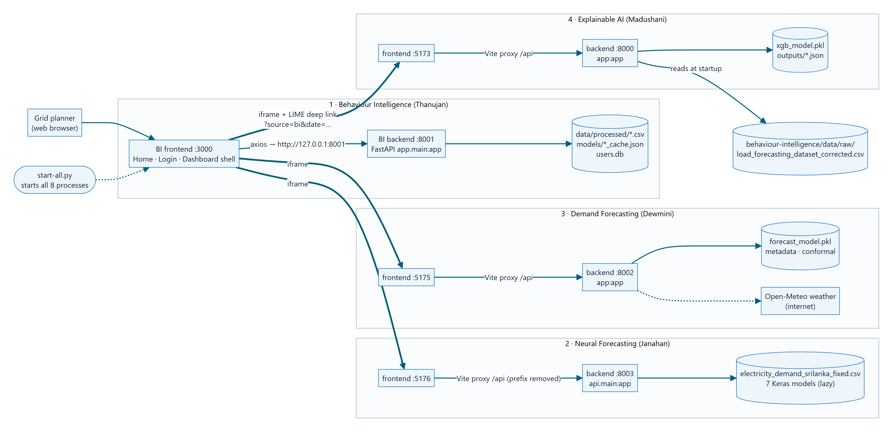

# R26-IT-010
## AI-Based Electricity Demand Intelligence System For Sri Lanka

Final-year research project, **SLIIT Faculty of Computing** · Supervisor: **Dr. Nathali Silva** · Panel: IT-P01

One web system for Sri Lankan grid planning. It learns how daily electricity demand behaves, forecasts demand, lets planners test "what-if" scenarios, and explains *why* the models predict what they predict. Four research components run as separate FastAPI + React apps. **Behaviour Intelligence** is the shell the user opens: home page, login, dashboard, and the other three apps inside it.



## Team and components

| # | Component | Member | Student ID | Folder | Backend | Frontend |
|---|---|---|---|---|---|---|
| 1 | Behaviour Intelligence (dashboard shell, login) | Thanujan T | IT22545176 | `behaviour-intelligence/` | :8001 | http://localhost:3000 |
| 2 | Neural (Adaptive) Forecasting | Janahan R | IT22069740 | `electricity-demand-sri-lanka/` | :8003 | http://localhost:5176 |
| 3 | Demand Forecasting & Scenario Analysis | Dewmini D.M.D.P | IT22630216 | `final_research/` | :8002 | http://localhost:5175 |
| 4 | Explainable AI (SHAP + LIME) | Madushani R.P | IT22273062 | `madushani_xai/` | :8000 | http://localhost:5173 |

Each component folder has its own detailed README. **`SYSTEM_OVERVIEW.md`** explains the whole integration: `start-all.py`, every API endpoint, the integration flows and troubleshooting.

## Requirements
- Windows 10/11 (the launcher uses Windows venv paths), **Python 3.12**, **Node.js 18+ / npm** (tested with Node 22)
- About 4 GB free disk space for the four Python environments and `node_modules`

## Setup (once)
Run these from the repository root in PowerShell. Every component has **its own virtual environment**, because their library versions conflict (for example scikit-learn 1.4 vs 1.9, and TensorFlow).

```powershell
# 1  Behaviour Intelligence
py -3.12 -m venv behaviour-intelligence\.venv
behaviour-intelligence\.venv\Scripts\python.exe -m pip install -r behaviour-intelligence\requirements.txt
cd behaviour-intelligence\frontend; npm install; cd ..\..

# 2  Neural Forecasting
py -3.12 -m venv electricity-demand-sri-lanka\.venv
electricity-demand-sri-lanka\.venv\Scripts\python.exe -m pip install -r electricity-demand-sri-lanka\requirements.txt
cd electricity-demand-sri-lanka\frontend; npm install; cd ..\..

# 3  Demand Forecasting (scikit-learn 1.9.1 matches the saved model)
py -3.12 -m venv final_research\venv
final_research\venv\Scripts\python.exe -m pip install -r final_research\backend\requirements.txt "scikit-learn==1.9.1"
cd final_research\frontend; npm install; cd ..\..

# 4  Explainable AI
py -3.12 -m venv madushani_xai\venv
madushani_xai\venv\Scripts\python.exe -m pip install -r madushani_xai\backend\requirements.txt
cd madushani_xai\frontend; npm install; cd ..\..
```

Note the folder names: BI and Neural use **`.venv`**, while Demand Forecasting and XAI use **`venv`**. `start-all.py` expects exactly these paths.

## Run

```powershell
python start-all.py                     # all 4 backends + 4 frontends
python start-all.py --only bi,xai       # only some components
```

Open **http://localhost:3000**. Log in with the demo account **demo@ceb.lk / Demo@2026** (role: Grid Planner), or sign up. Press **Ctrl+C** in the launcher window to stop everything.

To run without login (safety switch): `$env:AUTH_ENABLED = "false"; python start-all.py`.

Never start the Demand Forecasting backend with `python app.py`: that binds port 8000, which is the XAI port. The launcher uses the correct port, 8002.

## Repository layout

```
behaviour-intelligence/        Component 1: FastAPI backend, React dashboard, notebooks 01-07, data, models
electricity-demand-sri-lanka/  Component 2: 7 neural models (Models/<id>/runtime), API, dashboard
final_research/                Component 3: Gradient Boosting model, scenarios, Grid Decision Lab
madushani_xai/                 Component 4: XGBoost + SHAP/LIME, dashboard, viva pack
thesis_evidence/               Behaviour Intelligence evaluation tables and figures (incl. tuning, tables_v2 / figures_v2)
start-all.py                   Launcher for all components
SYSTEM_OVERVIEW.md             Integration guide (architecture, APIs, flows, troubleshooting)
```

## What is not in this branch
- **Environments and build output** (`venv`, `.venv`, `node_modules`, `__pycache__`, `dist`, `build`): recreate them with the setup steps above.
- **Local secrets and data:** `users.db` (login users) and `backend/.auth_secret` (token signing key) are created automatically on first start, and `.env` files are excluded. Only `final_research/backend/.env.example` is included; the app runs without a `.env`.
- **Backups and archived old versions:**
  - `final_research/backup_original_dataset/` (Dewmini's original datasets, about 52 MB): the `final_research` README links to it, so that link does not resolve here.
  - `madushani_xai/backend/outputs_backup_pp2/`
  - `behaviour-intelligence/archive_old_dataset/` and the `*_OLD` files.

  The Behaviour Intelligence backups are on the existing branch **`backup-thanujan-oct18`**. For the other backups, ask the component owner.
- No file is larger than 50 MB, so Git LFS is not needed. The largest files are the 15-minute datasets, at about 27 MB each.

## Datasets used
| Component | Dataset |
|---|---|
| Behaviour Intelligence | `behaviour-intelligence/data/raw/synthetic_realistic_load.csv` (generated by notebook 06, with 60 known anomaly days) |
| Explainable AI | `behaviour-intelligence/data/raw/load_forecasting_dataset_corrected.csv` (read by the XAI backend) |
| Demand Forecasting | `final_research/notebooks/load_forecasting_dataset_corrected.csv` (regenerated target, see its README) |
| Neural Forecasting | `electricity-demand-sri-lanka/data/electricity_demand_srilanka_fixed.csv` |

All datasets are synthetic or semi-synthetic research data, not real Ceylon Electricity Board data.
