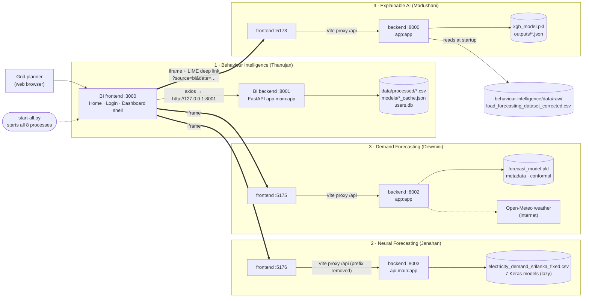
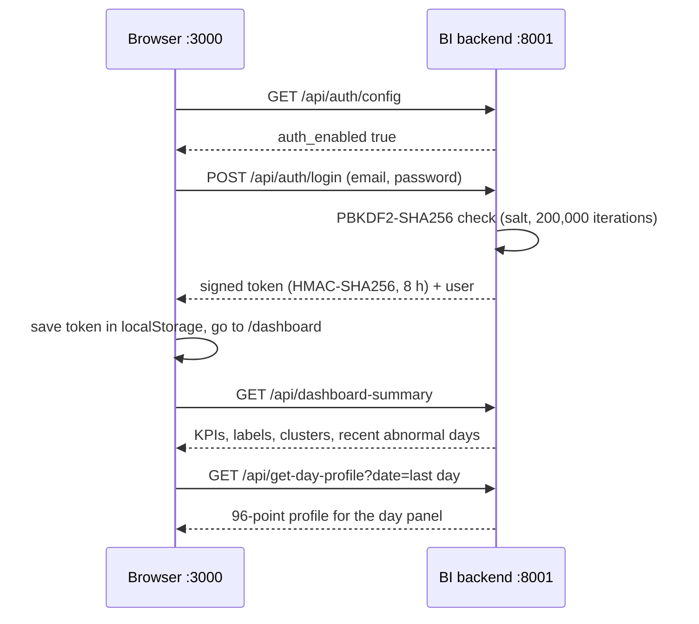
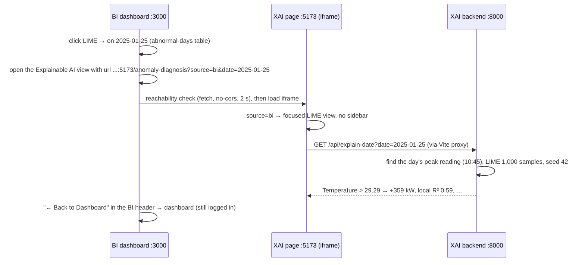
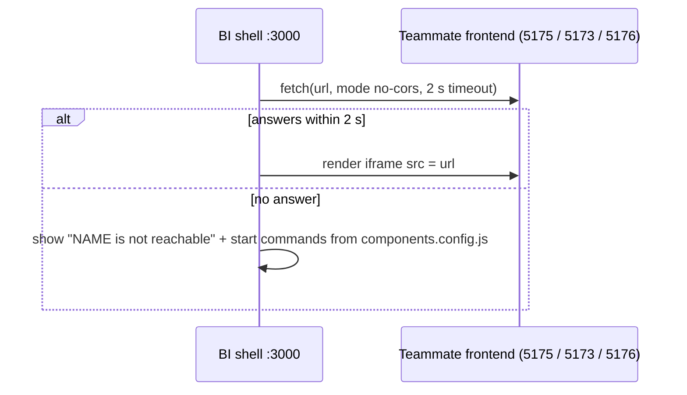
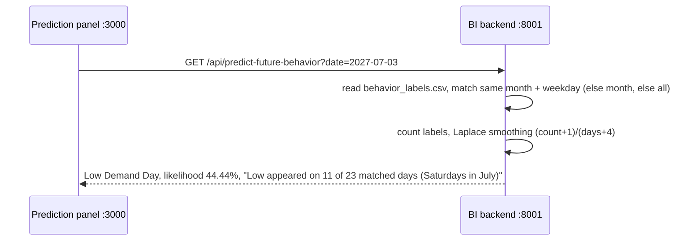
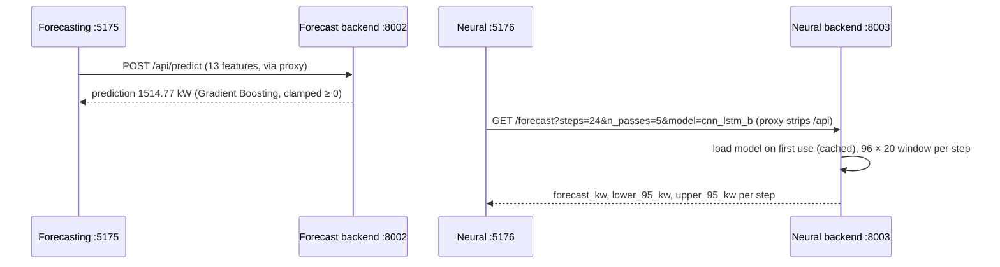

# System Overview: Electricity Demand Intelligence System (EDIS)

**Project R26-IT-010 · Panel IT-P01 · SLIIT · Supervisor: Dr. Nathali Silva** · checked against the code on 20 Oct 2026

> **Branch note.** The BI repository has the **home page, login, in-app LIME view, Tuning & Validation page and smoothed prediction** on branch **`home-login`**. That branch is what is currently checked out and running. It is **not merged** into `final-fixes` yet. On `final-fixes` there is no login, and the "LIME →" button opens Madushani's page in a **new tab** instead of inside BI.

## 1. Big picture

EDIS is one web system made of **four research components**. Each component is a separate app with its own **FastAPI backend** (Python) and **React + Vite frontend**. The **Behaviour Intelligence (BI)** app is the *shell* that the user opens: it has the home page, the login and a sidebar that shows the other three apps inside **iframes**.

| # | Component | Owner (ID) | Folder | What it answers |
|---|---|---|---|---|
| 1 | Behaviour Intelligence | Thanujan T (IT22545176) | `behaviour-intelligence/` | How does each day behave? Which days are abnormal? What will a future date look like? |
| 2 | Neural (Adaptive) Forecasting | Janahan R (IT22069740) | `electricity-demand-sri-lanka/` | What is the load in the next 15 minutes (7 deep-learning models, with uncertainty)? |
| 3 | Demand Forecasting & Scenarios | Dewmini D.M.D.P (IT22630216) | `final_research/` | What is demand for given conditions, what if they change, which provinces are at risk? |
| 4 | Explainable AI (SHAP + LIME) | Madushani R.P (IT22273062) | `madushani_xai/` | *Why* does the model predict this value? |

**How they work together:** they **do not call each other's APIs**. Integration happens in the browser:

1. BI embeds the three other frontends in iframes.
2. BI opens Madushani's LIME page for a chosen date with a URL parameter (`?source=bi&date=…`).
3. One launcher, `start-all.py`, starts all eight processes.

Mermaid source of the diagram

## 2. How `start-all.py` works (216 lines, standard library only)

1. **Configuration** (`start-all.py:49-116`): a `COMPONENTS` dictionary has one entry per component (`bi`, `xai`, `forecast`, `nn`). Each entry gives the backend's working folder, **its own venv Python**, the `uvicorn` arguments, the frontend folder and `npm run dev`, plus the URL to print.
2. **Options** (`:173-186`): `--only` takes a comma list (default `bi,xai,forecast,nn`). Unknown names stop with an error. Example: `python start-all.py --only bi,xai`.
3. **Start order** (`:191-196`): for each selected component, in the order `bi → xai → forecast → nn`:
   - start the **backend** with `"<venv python>" -m uvicorn …` (`subprocess.Popen(cmd, cwd=…, shell=True)`, `:133-134`), then wait 1.5 s;
   - start the **frontend** with `npm run dev` in its folder (`:147-148`), then wait 1.5 s.
4. **Safety checks** (`:126-131`, `:143-145`): if a folder or venv Python is missing, it prints `SKIP …` and continues with the others.
5. **URLs** (`:198-204`): it prints "Frontend URLs:" with one line per component, then "Press Ctrl+C to stop everything."
6. **Stop** (`:206-212`, `:153-170`): the script waits in a loop. **Ctrl+C** calls `stop_all()`, which runs `taskkill /F /T /PID <pid>` on Windows. That kills each child **and its whole process tree** (uvicorn and node).
7. **Environment:** the children inherit the shell's environment. So `$env:AUTH_ENABLED="false"; python start-all.py` turns BI login off.

| Key | Backend command (working folder) | Venv | Frontend folder |
|---|---|---|---|
| `bi` | `-m uvicorn app.main:app --port 8001` (`behaviour-intelligence/backend`) | `behaviour-intelligence/.venv` | `behaviour-intelligence/frontend` |
| `xai` | `-m uvicorn app:app --port 8000` (`madushani_xai/backend`) | `madushani_xai/venv` | `madushani_xai/frontend` |
| `forecast` | `-m uvicorn app:app --port 8002` (`final_research/backend`) | `final_research/venv` | `final_research/frontend` |
| `nn` | `-m uvicorn api.main:app --port 8003` (`electricity-demand-sri-lanka`) | `electricity-demand-sri-lanka/.venv` | `electricity-demand-sri-lanka/frontend` |

Never start Dewmini's backend with `python app.py`. Its `__main__` block binds **port 8000**, which collides with XAI (`final_research/backend/app.py`, last lines).

## 3. Ports and URLs

| Component | Frontend URL | Backend URL | API docs |
|---|---|---|---|
| Behaviour Intelligence | http://localhost:3000 (`/`, `/login`, `/signup`, `/dashboard`) | http://127.0.0.1:8001 | http://127.0.0.1:8001/docs |
| Explainable AI | http://localhost:5173 (`/temporal-drift`, `/anomaly-diagnosis`, `/model-xai-comparison`) | http://127.0.0.1:8000 | http://127.0.0.1:8000/docs |
| Demand Forecasting | http://localhost:5175 (tabs: Predict, Scenarios, Grid Decision Lab, Performance) | http://127.0.0.1:8002 | http://127.0.0.1:8002/docs |
| Neural Forecasting | http://localhost:5176 (`#overview`, `#forecast`, `#compare`, `#library`) | http://127.0.0.1:8003 | http://127.0.0.1:8003/docs |

## 4. API reference (read from the route code)

### 4.1 Behaviour Intelligence, port 8001
Routes are in `backend/app/api/routes.py` and `auth_routes.py`, both under the prefix `/api` (`main.py:23-24`). Responses are `{success, message, data}` unless noted.

| Method & path | Parameters | Returns | Used by |
|---|---|---|---|
| GET `/health` | none | `{status, app}` | health checks |
| GET `/api/dashboard-summary` (`routes.py:28`) | none | totals (1,977 days; Normal / Low / Peak / Abnormal), anomaly split, cluster meaning, label and risk distributions, recent abnormal days, all days | Dashboard |
| GET `/api/get-day-profile` (`:36`) | `date` | 96 points (`time_label, slot, value`), peak, mean, label, risk, reason | Dashboard day panel |
| GET `/api/predict-future-behavior` (`:32`) | `date` | predicted label, `likelihood_percent` (Laplace-smoothed), raw frequency and counts, match strategy and description, distributions | Future prediction panel |
| GET `/api/model-comparison` (`:40`) | none | K-Means / Ward / GMM / DBSCAN metrics, cluster interpretation; cached in `models/model_comparison_cache.json` | Model Comparison |
| GET `/api/anomaly-comparison` (`:44`) | none | Isolation Forest / LOF / One-Class SVM / z-score with bootstrap stability; cached | Anomaly Comparison |
| GET `/api/download-report` (`:48`) | optional `label` | CSV file stream of `behavior_labels.csv` | "Download report" buttons |
| GET `/api/tuning-evidence` (`:52`) | none | 9 sections with notes, 13 tables, figure names | Tuning & Validation |
| GET `/api/tuning-evidence/table/{name}`, `/figure/{name}` (`:56`, `:60`) | known file name only (404 otherwise) | one table (JSON) or one PNG | Tuning & Validation |
| POST `/api/generate-daily-profiles`, `/run-clustering`, `/run-anomaly-detection`, `/detect-peak-days`, `/generate-behavior-labels` (`:6-25`) | none | re-run one pipeline step | **No page.** These **overwrite** `data/processed/*.csv` and files in `models/`: do not call them in the viva |
| GET `/api/auth/config` (`auth_routes.py:20`) | none | `{auth_enabled, roles}` | every page load |
| POST `/api/auth/signup` (`:26`) | body: name, email, organisation, role, password, confirm_password | `{success, token, expires_at, user}` or 400 `{detail}` | Sign-up page |
| POST `/api/auth/login` (`:36`) | body: email, password | token + user, or 401 "Email or password is incorrect." | Login page |
| GET `/api/auth/me` (`:46`) | header `Authorization: Bearer <token>` | `{success, user}` or 401 | page load, tab focus, other tabs |
| POST `/api/auth/logout` (`:54`) | Bearer token | revokes the token | Logout button |

### 4.2 Explainable AI, port 8000 (`madushani_xai/backend/app.py`)

| Method & path | Parameters | Returns | Used by |
|---|---|---|---|
| GET `/` (`:133`) | none | status message | none |
| GET `/api/temporal-drift` (`:139`) | none | `temporal_drift.json` (SHAP importance per year) | Page 01 |
| GET `/api/anomaly-diagnosis` (`:151`) | none | 15 saved LIME instances | Page 02 |
| GET `/api/explain-date` (`:184`) | `date` | live LIME for that day's **peak reading**: actual, predicted, error, demand level, `lime_r2`, `contributions[]`, … (503 if model or dataset missing, 422 bad date, 404 no data) | Page 02 (focused BI view) |
| GET `/api/v2/model-comparison`, `/v2/xai-comparison`, `/v2/temporal-drift` (`:162-174`) | none | v2 JSON results | Page 03 |
| GET `/api/figures/<file>.png` (static mount, `:34`) | file name | PNG figure | Page 03 |

### 4.3 Demand Forecasting & Scenarios, port 8002 (`final_research/backend/app.py`, `grid_lab.py`)

| Method & path | Parameters | Returns | Used by |
|---|---|---|---|
| GET `/api/model-info` (`app.py:46`) | none | model type, features, metrics, comparison, importances | header and Performance tab |
| POST `/api/predict` (`:105`) | JSON of the 13 features | `{prediction, unit:"kW", input_features, prediction_number}`, clamped ≥ 0 | Predict tab; Scenarios tab (baseline and each scenario) |
| GET `/api/scenarios` (`:144`) | none | pre-computed `outputs/scenario_results.json` | Scenarios tab |
| POST `/api/scenario-test` (`:157`) | `{baseline, modifications}` | baseline vs scenario prediction, change | API only |
| GET `/api/reference`; POST `/api/curve`, `/api/explain`, `/api/sensitivity` (`:218-289`) | inputs, hour | ranges; 24-h curves; attributions; tornado | API only (`ControlRoom.jsx` is not mounted) |
| GET `/api/health` (`:314`) | none | `{status, model_loaded, endpoints}` | health checks |
| POST `/api/decision` (`grid_lab.py:127`) | day, weather source, capacity, shift / tariff / reserve | regional demand, 90% range, overload probability | Grid Decision Lab |
| GET `/api/live-weather` (`:65`), `/api/regions` (`:72`); POST `/api/recommend` (`:157`) | none / body | Open-Meteo weather (cached 15 min); provinces; best mitigation | API only |
| GET `/api/performance` (`:180`) | none | `saved_models/performance.json` | Performance tab |

The Grid Lab routes exist only if the model loaded (`app.py`: `if model: grid_lab.register(...)`).

### 4.4 Neural Forecasting, port 8003 (`api/routers/behaviour.py`, `models.py`)

| Method & path | Parameters | Returns | Used by |
|---|---|---|---|
| GET `/health` (`behaviour.py:34`) | none | service and data status | app start |
| GET `/data/range`, `/data/source` (`:61`, `:75`) | none | dataset time range and valid forecast start; source info | app start |
| GET `/demand/live` (`:96`) | none | latest reading in the dataset | Overview |
| GET `/demand/historical` (`:108`) | `hours` (1–168, default 24), `end_timestamp` | demand series | Overview (48 h) |
| GET `/analysis/heatmap` (`:144`) | none | hour × day demand heatmap | Overview |
| GET `/model/metrics` (`:168`) | `model` | metrics of one model | Overview / Forecast |
| GET `/api/models` (`models.py:28`); `/models` (`:32`, legacy) | none | registry of 7 models, `default_model_id` = `cnn_lstm_b` | Forecast, Library |
| GET `/api/comparison` (`:49`) | `sample_limit` (600) | aligned metrics, ranking, significance tests | Compare, Library, Overview |
| GET `/forecast` (`:76`) | `steps`, `n_passes` (1–100), `start_timestamp`, `include_actuals`, `model` | one-step forecasts with `lower_95_kw`, `upper_95_kw` for MC models | Forecast page |
| POST `/api/predict`, `/api/compare` (`:36`, `:41`) | `values` 96 × 20, `forecast_timestamp`, model id(s) | prediction(s) | API only |

## 5. How the frontends call the backends

| Frontend | How it calls | CORS on the backend |
|---|---|---|
| BI :3000 | **Direct**, no proxy: `BASE_URL = 'http://127.0.0.1:8001'` in `App.jsx:17`, `ModelComparison.jsx`, `AnomalyComparison.jsx`, `FutureBehaviorPrediction.jsx`, `TuningValidation.jsx`; `API_URL` in `auth.js:6` | `allow_origins = [http://localhost:3000, http://localhost:3001]` (`main.py:17`) |
| XAI :5173 | relative `/api/...`; the Vite proxy sends `/api` to `http://localhost:8000` (`vite.config.js`) | `allow_origins = [5173, 3000]` (`app.py:22`) |
| Forecasting :5175 | relative `/api/...` (`API_BASE = ''`); Vite proxy to `http://127.0.0.1:8002` | `[5173, 5174, 5175, 3000]` (`app.py:15`) |
| Neural :5176 | `BASE = "/api"` (`api.js:3`); the Vite proxy sends it to `http://127.0.0.1:8003` and **removes the first `/api`**. So `/api/forecast` → `/forecast` and `/api/api/models` → `/api/models` | list (5173, 3000, 5176, …) **plus** regex `http://(localhost|127.0.0.1):<any port>` (`main.py`) |

Because the teammate apps call their APIs through their **own** Vite proxy (same origin as the iframe), they work unchanged inside BI's iframes.

## 6. Integration flows

### a) Login → dashboard loads
`Root.jsx` controls the pages. The token is kept in **localStorage** (token only), so all tabs share one login.

On a reload, the page calls `GET /api/auth/me` with the token. A 401 (expired, tampered or logged-out token) clears it and sends the user to `/login` (`Root.jsx:87-88`). Logging out in one tab logs out all tabs through the browser `storage` event (`:106`).

### b) "LIME →" for 2025-01-25 → explanation inside BI

If the user clicks Madushani's own "Back to Dashboard" link (to `localhost:3000`) instead, BI sees that the visitor came from the XAI app and goes to `/dashboard`. Inside the iframe, BI reloads the whole window instead of loading BI inside itself (`Root.jsx:17-32`).

### c) Sidebar → teammate apps in iframes

`TeammateComponentView.jsx:19-22` does the check. The URLs and start commands come from `components.config.js`.

### d) Future behaviour prediction

### e) Teammate examples

## 7. What each backend loads

| Backend | At startup | Per request |
|---|---|---|
| **BI 8001** | `auth.init_db()` creates the `users.db` tables and the demo account `demo@ceb.lk` (`main.py:27`); the signing key `backend/.auth_secret` is created on first use. **No ML model is loaded.** | `data/processed/behavior_labels.csv`, `daily_profiles.csv`, `clustering_results.csv`, `anomaly_results.csv`; `models/*_cache.json`; `thesis_evidence/tables_v2`, `figures_v2`. The `.pkl` models are used only by the POST pipeline steps. |
| **XAI 8000** | `outputs/xgb_model.pkl`, plus the dataset **`behaviour-intelligence/data/raw/load_forecasting_dataset_corrected.csv`** (`app.py:54-58`, `94-131`); IQR cleaning; LIME explainer with a 2,000-row background, seed 42 | `outputs/*.json`, `outputs/v2/*.json`, `outputs/figures/*.png` |
| **Forecast 8002** | `saved_models/forecast_model.pkl` (GradientBoostingRegressor, scikit-learn 1.9.1), `model_metadata.json`, `reference.json`; `conformal.json` (Grid Lab) | `outputs/scenario_results.json`, `saved_models/performance.json`; Open-Meteo weather over the internet |
| **Neural 8003** | `data/electricity_demand_srilanka_fixed.csv` (`main.py:42`); models are **lazy** | on first use: `Models/<id>/runtime/best_model.keras` + scalers, then cached (`model_service.py:27-36`) |

**The datasets differ:** BI uses `synthetic_realistic_load.csv`, XAI uses `load_forecasting_dataset_corrected.csv`, Dewmini uses her notebook copy, and Janahan uses `electricity_demand_srilanka_fixed.csv`. The same date can therefore show different kW values in different components.

## 8. Viva questions on integration (short answers)

- **How do the components communicate?** Through the browser, not backend to backend. BI embeds the other apps in iframes and passes a date to the XAI page in its URL. Each frontend talks only to its own backend over REST/JSON.
- **Why separate services?** Each member's stack and library versions conflict (for example scikit-learn 1.4 in BI vs 1.9 in Forecasting; TensorFlow in Neural). Separate services with their own venvs keep each one stable, testable and replaceable.
- **What happens if one service is down?** Only that part stops. BI checks each iframe target first (2 s) and shows "not reachable" with the start command. If the XAI backend is down, the LIME page shows an error, but the BI dashboard still works.
- **How is login secured?** Passwords are hashed with PBKDF2-HMAC-SHA256 and a random salt (never stored in plain text). Sessions use an HMAC-signed token with an 8-hour expiry, which the server checks on `/api/auth/me`. Logout revokes the token. Python standard library only; users live in a gitignored SQLite file.
- **Is the data API protected?** No: login protects the **pages**. The data endpoints stay open so the iframes, report download and LIME link keep working. This is a known limitation (future: role-based API checks).
- **How does the LIME button know which day to explain?** BI puts the date in the URL. The XAI page reads `source=bi&date=…`, calls `/api/explain-date`, and explains that day's highest-demand reading.
- **How do you start everything?** Run `python start-all.py`: 4 backends and 4 frontends, each with its own venv; Ctrl+C stops the whole process tree.
- **Can login be switched off if it fails?** Yes: `AUTH_ENABLED=false` before starting. The home page stays and "Open dashboard" goes straight in.
- **How do frontends avoid CORS problems?** The teammate apps use a Vite proxy (same origin). BI calls its backend directly, and that backend allows `localhost:3000`.

## 9. Quick troubleshooting

| Symptom | Likely cause | Fix |
|---|---|---|
| "Port 3000 is in use, trying another one…" or `[Errno 10048]` | an old `start-all` is still running, so the new one lands on 3001/5174 or its backends fail | stop the old one with **Ctrl+C**; check with `Get-NetTCPConnection -LocalPort 8001`; start again |
| Login works, then **404** on `/api/auth/...` | the backend was started from older code (another branch) | stop, `git checkout home-login`, restart (uvicorn does not reload) |
| Dashboard says it cannot load data | BI backend 8001 not running | check http://127.0.0.1:8001/health |
| Teammate page shows "not reachable" | that frontend (5173/5175/5176) is not running | `python start-all.py --only xai` (or `forecast` / `nn`) |
| Iframe is empty but the page loaded | the frontend is up, but its backend is down | check its backend `/docs` (8000 / 8002 / 8003) |
| LIME says "Live explainer not available" (503) | XAI started from a copy outside the workspace, so the dataset path `../../behaviour-intelligence/data/raw/…` is missing | start from the workspace: `python start-all.py` |
| Grid Lab shows a fallback scenario | no internet for Open-Meteo | expected offline; it uses 28 °C / 80% |
| Neural forecast is slow the first time | the model loads lazily on first use | wait; later calls are cached |
