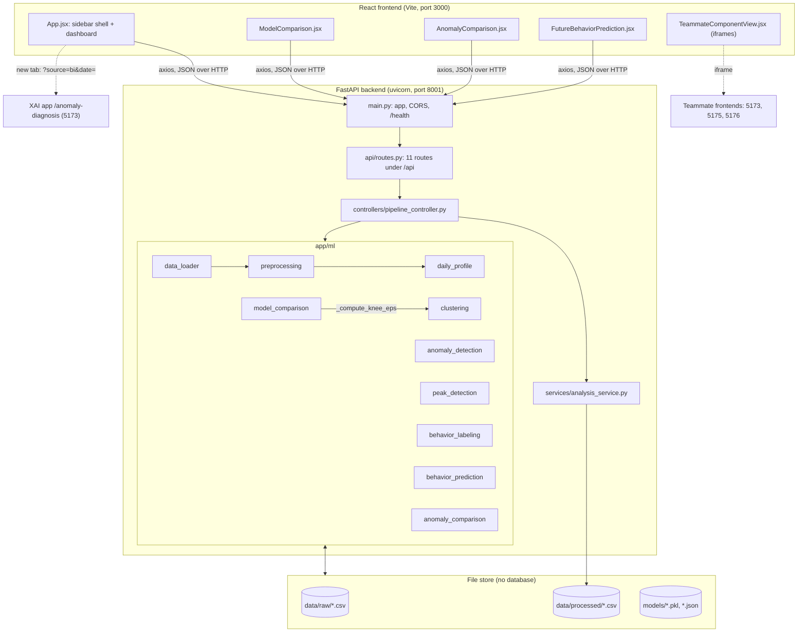
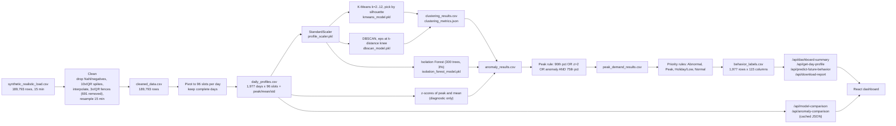

# Thesis Evidence File: Behaviour Intelligence Component

| | |
|---|---|
| Student | Thanujan T (IT22545176) |
| Project | R26-IT-010, "AI-Based Electricity Demand Intelligence System for Sri Lanka" |
| Supervisor | Dr. Nathali Silva |
| Component | Behaviour Intelligence (`./behaviour-intelligence`) |
| Evidence gathered | 2026-10-10 |

**How to read this file.** Every number is followed by its source. Three kinds of source are used:

- **[code]** a file and line in `behaviour-intelligence/`.
- **[saved]** a result file already in the repository (for example `models/clustering_metrics.json`).
- **[run]** a value measured on 2026-10-10 by `thesis_evidence/scripts/eval_all.py` or `thesis_evidence/scripts/api_smoke_test.py`. These two scripts were written to gather this evidence; they are not part of the component. They call the component's own functions inside a scratch copy, so nothing in `behaviour-intelligence/data` or `behaviour-intelligence/models` was modified. Full output: `thesis_evidence/tables/eval_summary.json`.

Anything that could not be verified is marked **NOT FOUND – needs confirmation**.

## Read this first: seven findings that affect what the thesis can claim

1. **The analysed dataset is synthetic, not CEB data.** The pipeline reads `data/raw/synthetic_realistic_load.csv` [code: `backend/app/core/config.py:11`]. No generator script, source note or licence for it exists anywhere in the repository. Its provenance is NOT FOUND – needs confirmation. The proposal specified Ceylon Electricity Board data (proposal PDF p. 20, section 3.1).
2. **All saved results reproduce exactly.** Re-running the pipeline gives 0 mismatches against the saved `behavior_labels.csv` on labels, clusters, anomaly flags and peak flags, and identical clustering metrics [run: `reproduction_vs_saved`]. The same numbers were also obtained under a second environment (scikit-learn 1.5.1) [run: `api_smoke_test.py`].
3. **Defect: 69 of the 281 "Peak Demand Day" labels are the lowest-peak days in the dataset.** `peak_zscore` is stored as an absolute value [code: `anomaly_detection.py:56`], and the peak rule tests `peak_zscore > 2.0` [code: `peak_detection.py:41`]. All 69 days caught by that rule have a peak below the dataset mean (1,946 to 2,076 kW against a mean of 2,592 kW), and all 69 fall on weekends [run: `peak`]. With a signed z-score the label counts would be Peak 212 and Holiday / Low 465. See section 4.3.
4. **`models/behavior_label_summary.json` is stale.** It reports Peak 212 and Holiday 465 (written 2026-08-25). The file the dashboard actually serves, `data/processed/behavior_labels.csv` (written 2026-09-01), contains Peak 281 and Holiday 396. Use the CSV numbers, or fix finding 3 and regenerate both.
5. **Outlier cleaning removes the demand spikes before peak detection sees them.** The 3×IQR filter deletes all 691 readings above 2,928.49 kW (raw maximum 4,365.20 kW) and interpolates over them. These readings sit on 267 different days [run: follow-up analysis, section 2.3].
6. **Isolation Forest was "selected" over LOF by a tie.** The two flag the identical 60 days and have identical stability scores (mean Jaccard 0.7769). Isolation Forest ranks first only because it is listed first and Python's sort is stable [code: `anomaly_comparison.py:438-473`]. See section 4.2.
7. **There are no ground-truth anomaly labels, so precision, recall and F1 cannot be computed.** The code says so itself [saved: `models/anomaly_metrics.json`, `note` field]. Proposal objective 2.2.6 (anomaly precision against known real events, expert review) is not done.

---

## 0. Repository map

### 0.1 Tree of `./behaviour-intelligence`

```
behaviour-intelligence/
├── backend/app/
│   ├── main.py                      FastAPI app, CORS, /health
│   ├── api/routes.py                11 routes under /api
│   ├── controllers/pipeline_controller.py   one function per route; try/except envelope
│   ├── core/config.py               paths, dataset filename, ports
│   ├── services/analysis_service.py dashboard summary + single-day profile queries
│   ├── schemas/response_models.py   Pydantic models (defined, not attached to any route)
│   ├── database/                    empty package (no database is used)
│   └── ml/
│       ├── data_loader.py           read CSV, parse timestamp + demand
│       ├── preprocessing.py         cleaning, IQR filtering, 15-min resampling
│       ├── daily_profile.py         96-slot daily profiles
│       ├── clustering.py            StandardScaler, K-Means k-sweep, DBSCAN at k-distance knee
│       ├── anomaly_detection.py     Isolation Forest, z-score diagnostics
│       ├── peak_detection.py        percentile / z-score / anomaly peak rule
│       ├── behavior_labeling.py     priority rules -> 4 labels + risk level + reason text
│       ├── behavior_prediction.py   historical frequency matching for a future date
│       ├── model_comparison.py      K-Means vs DBSCAN vs Agglomerative vs GMM
│       ├── anomaly_comparison.py    IF vs LOF vs One-Class SVM vs z-score, bootstrap stability
│       ├── pipeline_runner.py       run_full_pipeline(): the 5 stages in one call
│       ├── train_models.py          older standalone training script (now diverges; see 8.2)
│       └── verify_pkl_models.py     loads each .pkl and prints its parameters
├── frontend/
│   ├── src/App.jsx                  sidebar shell + dashboard view
│   ├── src/ModelComparison.jsx      clustering comparison page
│   ├── src/AnomalyComparison.jsx    anomaly comparison page
│   ├── src/FutureBehaviorPrediction.jsx   prediction panel
│   ├── src/TeammateComponentView.jsx      iframe wrapper with health check
│   ├── src/components.config.js     teammate URLs / owners / start commands
│   ├── src/format.js, main.jsx, App.css
│   ├── src/App.js, FutureBehaviorPrediction.js, index.js   legacy Create-React-App files, unused by Vite
│   ├── build/                       stale Create-React-App build output
│   ├── index.html, vite.config.js, package.json
├── data/raw/                        synthetic_realistic_load.csv (in use), load_forecasting_dataset_corrected.csv (earlier)
├── data/processed/                  6 pipeline CSVs + 6 *_OLD copies from the earlier dataset
├── models/                          4 .pkl, 3 metrics .json, 2 comparison caches, *_OLD copies
├── notebooks/                       01–05 step notebooks, 06 is an empty file
├── reports/                         earlier-dataset comparison reports and figures
├── scripts/recreate_notebooks.py    regenerates notebooks 01–05 with nbformat
├── test_zscore_thresholds.py        10-line diagnostic script (not a unit test)
├── COMPONENT_AUDIT.md               self-audit dated 2026-08-25 (describes the earlier dataset)
├── README.md                        PP1 README (identical copy: IT22545176_Thanujan T_Readme.md)
└── requirements.txt
```

### 0.2 Lines of code by language

Counted with `wc -l` over tracked and untracked files, excluding `node_modules`, `frontend/build`, `package-lock.json`, CSV, `.pkl` and `*_OLD` files [run].

| Language | Files | Lines | Note |
|---|---:|---:|---|
| Python | 29 | 4,268 | includes `scripts/recreate_notebooks.py` (1,250) and `train_models.py` (663) |
| JSX | 6 | 1,693 | the live Vite frontend |
| JavaScript | 6 | 880 | 809 of these are the three legacy CRA files |
| CSS | 1 | 1,247 | `App.css` |
| HTML | 2 | 32 | |
| Jupyter notebooks | 6 | 2,220 | raw JSON lines; notebook 06 is 0 bytes |
| Markdown | 6 | 1,961 | |
| JSON | 7 | 429 | metrics, caches, package.json |

Largest source files: `train_models.py` 663, `App.jsx` 623, `anomaly_comparison.py` 531, `model_comparison.py` 446, `AnomalyComparison.jsx` 390, `ModelComparison.jsx` 342, `FutureBehaviorPrediction.jsx` 244, `clustering.py` 227, `pipeline_controller.py` 223.

### 0.3 Git history

Source: `git log` run inside `behaviour-intelligence/` (the repository lives there; the workspace root is not a git repository).

- Remote `origin` = `https://github.com/Jana1805/R26-IT-010.git`, branch `IT22545176-Thanujan`.
- **9 commits**, 2026-04-30 to 2026-05-13. One is the group's initial commit (author "Pramodya"); 8 are by Thanujan T, all between 2026-05-10 and 2026-05-13.

| Hash | Date | Message | Size |
|---|---|---|---|
| e59a657 | 2026-04-30 | Initial commit (Pramodya) | 1 file, +2 |
| e6f9f1b | 2026-05-10 | chore: initial project structure with base files and folder scaffold | 18 files, +192 |
| 5dfeb87 | 2026-05-10 | feat(ml): add complete 5-stage ML pipeline (preprocessing, clustering, anomaly detection, peak detection, behavior labeling, prediction) | stat not shown by git for this path |
| 2f3cbd2 | 2026-05-11 | feat(api): add routes, controllers, analysis service, schemas, and wire up FastAPI main.py | 5 files, +367 −2 |
| 4df11c5 | 2026-05-11 | feat(frontend): add React dashboard with KPI cards, charts, day profile viewer, and future prediction widget | 8 files, +21,419 |
| 85244ca | 2026-05-11 | fix(config): resolve project root relative to config file location | 1 file, +4 −9 |
| b609b28 | 2026-05-11 | Completed ML part (train_models.py, notebooks 01–05, reports, metrics) | 26 files, +4,250 −64 |
| f2fb63d | 2026-05-11 | XAI-component (LIME buttons and anomaly alert in the frontend) | 3 files, +227 −3 |
| 9c41305 | 2026-05-13 | Add comprehensive README for PP1 submission | 1 file, +272 −113 |

**Important: everything after 2026-05-13 is uncommitted.** `git status` shows 25 modified tracked files (+4,246 −20,438, most of the deletions being `package-lock.json`) and 41 untracked files. Milestones after PP1 can therefore only be dated from file modification times:

| File date | What changed (uncommitted) |
|---|---|
| 2026-08-25 | Dataset switched to `synthetic_realistic_load.csv`; `reports/model_comparison*.csv|md` and `reports/figures/` written; `COMPONENT_AUDIT.md`; `train_models.py` last edited |
| 2026-08-31 | `model_comparison.py`, `anomaly_comparison.py`, rewritten `clustering.py` (knee-based DBSCAN) and `anomaly_detection.py` (z-score removed from the final flag); Vite JSX frontend, sidebar shell, both comparison pages, teammate iframe view |
| 2026-09-01 | Pipeline re-run (all processed CSVs and `.pkl` files), comparison caches, `/download-report` endpoint, final `App.jsx`/`App.css` |

Commit this work before submission; at present the git history does not show any of the model-comparison work.

---

## 1. Introduction material

### 1.1 Problem solved, as implemented

The component turns a 15-minute electricity load time series into one interpretable record per day. For each of 1,977 days it produces a 96-point load profile, a K-Means cluster, a DBSCAN cluster or noise flag, an Isolation Forest anomaly score and flag, a peak-day flag with a text reason, and a final behaviour label with a risk level and a text reason. It serves these through a REST API and a React dashboard, compares alternative clustering and anomaly algorithms on a dedicated page each, and estimates the likely label of a future date from historical frequencies.

### 1.2 Actual label set

Exactly four labels, each with a fixed risk level [code: `behavior_labeling.py:7-11`, `behavior_prediction.py:5-17`].

| Label (exact string) | Risk level | Days | Share |
|---|---|---:|---:|
| `Normal Weekday Demand` | Normal | 1,279 | 64.69% |
| `Peak Demand Day` | Medium | 281 | 14.21% |
| `Holiday / Low Demand Day` | Low | 396 | 20.03% |
| `Abnormal Demand Day` | High | 21 | 1.06% |

Source: [saved] `data/processed/behavior_labels.csv`, confirmed by [run]; table `T20_behaviour_label_distribution.csv`. There is no separate "weekend" or "seasonal" label.

### 1.3 Proposal objectives against what the code achieves

Proposal source: `R26-IT-010-IT22545176-Thanujan T.pdf`, sections 2.2 and 3 (pp. 18–22) and Table 2 (pp. 28–30).

| # | Proposal objective | Status | Evidence |
|---|---|---|---|
| 2.2.1 | Preprocess: missing values, abnormal measurements, standardise | **Achieved** | `preprocessing.py`, `StandardScaler` in `clustering.py:121`. Caveat: the filter also removes genuine spikes (finding 5) |
| 2.2.2 | Aggregate into 96-point daily profiles | **Achieved** | `daily_profile.py`; 1,977 profiles |
| 2.2.3 | K-Means and DBSCAN clustering to find weekday, weekend, holiday and seasonal patterns | **Achieved for K-Means; DBSCAN run but degenerate** | K-Means k=2 separates weekdays from weekends (99.14% agreement). DBSCAN returns one cluster plus 60 noise days. No holiday or seasonal cluster emerges |
| 3.2 | Choose k with the Silhouette coefficient **and Elbow method** | **Changed** | Code selects k by silhouette only (`clustering.py:34-46`). Inertia is never computed in the component. An elbow curve was produced for this file (figure F01) |
| 2.2.4 | Isolation Forest and Z-Score anomaly detection | **Changed** | Isolation Forest is the only detector that sets the final flag. Z-score is computed and stored but deliberately excluded because it flags 0 days at threshold 3.0 (`anomaly_detection.py:9-16, 98`) |
| FR7 | Peak-day detection from anomaly scores, cluster characteristics and magnitude thresholds | **Achieved, with a defect** | `peak_detection.py`. Does not use clusters. Contains the absolute-z defect (finding 3) |
| 2.2.5 | Labels derived from "cluster assignment, anomaly score, peak magnitude and calendar context" | **Changed** | Labels use the anomaly flag, peak flag and a mean-demand quantile only. Cluster assignment and calendar context are not inputs (`behavior_labeling.py:28-57`) |
| 2.2.6 | Evaluate: clustering quality, anomaly precision against known events, expert review of labels | **Partly done** | Silhouette, Davies–Bouldin and Calinski–Harabasz are computed. Precision/recall/F1: not done (no labels). Expert review: NOT FOUND |
| 3.5 | Visualisation with Matplotlib/Seaborn; calendar-based behaviour maps | **Changed** | Visualisation is an interactive React + Recharts dashboard. No calendar map exists |
| FR11 | Expose outputs to Forecast, XAI and Scenario services | **Partly done** | A UI deep link to the XAI app and a CSV download exist. No teammate component calls this API (section 6.5) |
| FR12 | REST API | **Achieved** | 12 routes (section 6.2) |
| NFR Security | TLS and JWT authentication | **Not done** | No authentication, plain HTTP on localhost |
| 3.1 | CEB data with holiday and seasonal flags | **Changed** | Synthetic dataset; no holiday or calendar feature is used |

### 1.4 Features added beyond the proposal

1. Clustering model comparison across four algorithms with a third index (Calinski–Harabasz) and mean-rank selection [code: `model_comparison.py`].
2. Anomaly detector comparison across four methods (adds Local Outlier Factor and One-Class SVM), ranked by bootstrap stability, with a pairwise Spearman diagnostic [code: `anomaly_comparison.py`].
3. Data-driven DBSCAN `eps` from the k-distance knee, replacing a retry loop, plus explicit "degenerate" status reporting [code: `clustering.py:49-88, 185-190`].
4. Future behaviour prediction with a confidence percentage and probability distribution [code: `behavior_prediction.py`].
5. Human-readable reason text for every label and every peak flag [code: `behavior_labeling.py:36-57`, `peak_detection.py:46-56`].
6. Risk levels attached to labels.
7. Full-stack delivery: FastAPI backend and React/Vite dashboard (the proposal's tool table lists only Python, Matplotlib and Jupyter for this module).
8. CSV report download with optional label filter [code: `pipeline_controller.py:189-223`].
9. File-based result caching for the two comparison endpoints, invalidated when `daily_profiles.csv` changes [code: `model_comparison.py:59-86`].
10. Integrated shell: a sidebar that embeds the three teammate applications in iframes after a 2-second reachability check [code: `TeammateComponentView.jsx`].
11. Deep link from abnormal days to the teammate's LIME page [code: `App.jsx:16-24`].
12. Model file verification script [code: `verify_pkl_models.py`].

---

## 2. Data

### 2.1 Datasets

Two raw files are present. Only the first is used by the current code.

| | In use | Earlier (PP1) |
|---|---|---|
| File | `data/raw/synthetic_realistic_load.csv` | `data/raw/load_forecasting_dataset_corrected.csv` |
| Size | 7.54 MB | 26.27 MB |
| Rows × columns | 189,793 × 4 | 189,888 × 15 |
| Time range | 2020-01-01 00:00 to 2025-05-31 00:00 | 2020-01-01 00:00 to 2025-05-31 23:45 |
| Granularity | 15 minutes (every step is 15 min; 0 duplicates; 0 nulls) | 15 minutes |
| Source | **NOT FOUND – needs confirmation.** No generator script or provenance note in the repository | NOT FOUND – needs confirmation |

Source: [run] `raw` block of `eval_summary.json` and a direct pandas inspection.

**Columns of the dataset in use**

| Column | Meaning | Used by the pipeline? | Range |
|---|---|---|---|
| `Timestamp` | reading time | yes | see above |
| `Load Demand (kW)` | load | yes, the only modelled variable | 629.73 to 4,365.20; mean 1,747.81; std 349.74 |
| `Temperature (°C)` | air temperature | **no** | 18.79 to 32.80; mean 26.00 |
| `Solar Irradiance (W/m²)` | irradiance | **no** | 0 to 899.9; mean 229.04 |

The loader takes only the timestamp and demand columns [code: `data_loader.py:7-8, 20-21`]. Weather is never read, so the component uses no weather features. Correlation of load with temperature is 0.155 and with irradiance −0.243 [run].

**Why the dataset was changed.** `reports/model_comparison.md` (2026-08-25) records the diagnosis of the earlier file: mean correlation between adjacent 15-minute slots 0.003, 82 of 96 principal components needed for 90% of variance, 250 W/m² irradiance at midnight, temperature identical at every hour, and a correlation of 1.000000 between load and temperature. Its conclusion: "the supplied dataset is synthetic and contains no temporal or cross-variable structure." On that file K-Means reached a silhouette of only 0.0097 [saved: `models/clustering_metrics.json_OLD`].

The same two diagnostics, recomputed on both datasets [run: `structure_diagnostics`]:

| Diagnostic | Earlier dataset | Dataset in use |
|---|---:|---:|
| Mean adjacent-slot correlation | 0.003 | 0.6217 |
| PCA components for 90% of variance | 83 | 33 |

(The report says 82 for the earlier file; this run gives 83, a one-component difference probably from how the 90% boundary is counted.)

**Structure visible in the dataset in use** [run: `demand_by_dow`, follow-up analysis]:

- Weekdays are flat and near-identical: mean demand 1,834 to 1,840 kW Monday to Friday; 1,508 and 1,509 kW on Saturday and Sunday.
- A smooth annual cycle: monthly mean load rises from 1,609 kW in December to 1,890 kW in June.
- No growth trend: yearly means 1,745 to 1,752 kW across 2020–2025.
- One evening peak; the mean profile peaks at 19:30 (figure F13).

These regularities are what a generator would produce. Real Sri Lankan events (COVID lockdowns in 2020–21, the 2022 load-shedding period, Sinhala and Tamil New Year, Vesak) leave no trace: yearly means do not move and 2022 looks like every other year.

### 2.2 Daily profile table

`data/processed/daily_profiles.csv`: 1,977 rows × 100 columns: `date`, `p00`…`p95` (load in kW for each 15-minute slot, `p00` = 00:00, `p95` = 23:45), `peak_demand` (row maximum), `mean_demand` (row mean), `std_demand` (row standard deviation) [code: `daily_profile.py:32-35`].

| Statistic | `peak_demand` (kW) | `mean_demand` (kW) |
|---|---:|---:|
| Minimum | 1,946.41 | 1,217.41 |
| 25th percentile | 2,416.57 | 1,616.61 |
| Median | 2,635.58 | 1,763.90 |
| Mean | 2,591.71 | 1,743.22 |
| 75th percentile | 2,819.01 | 1,911.48 |
| Maximum | 2,928.45 | 2,008.02 |
| Skewness | −0.604 | −0.415 |

Range 2020-01-01 to 2025-05-30; 1,413 weekdays and 564 weekend days [run: `profiles`].

### 2.3 Preprocessing steps, in order

Driver: `preprocess_timeseries()` [code: `preprocessing.py:59-68`]. Row counts from [run], table `T01_preprocessing_steps.csv`.

| # | Step | Code | Rows after | Effect on this dataset |
|---|---|---|---:|---|
| 0 | Load, parse timestamp, coerce demand to numeric, sort | `data_loader.py:17-30` | 189,793 | |
| 1 | Drop NaN and negative demand | `preprocessing.py:4-8` | 189,793 | none removed |
| 2 | Drop spikes above median + 10×IQR (5,190.72 kW) | `preprocessing.py:11-18` | 189,793 | none removed |
| 3 | Linear interpolation both ways, then ffill/bfill | `preprocessing.py:21-25` | 189,793 | nothing to fill |
| 4 | Drop values outside Q1 − 3×IQR, Q3 + 3×IQR = [485.49, 2,928.49] kW | `preprocessing.py:28-36` | 189,102 | **691 removed (0.364%), all on the high side** |
| 5 | Resample to 15-minute means, interpolate gaps | `preprocessing.py:39-46` | 189,793 | the 691 gaps are re-filled by interpolation |
| 6 | Add `Date`, `Hour`, `TimeSlot = Hour×4 + minute//15` | `preprocessing.py:49-56` | 189,793 | |
| 7 | Pivot to date × slot, keep days with all 96 slots | `daily_profile.py:15-23` | 1,977 days | 2025-05-31 dropped (1 slot only) |

```python
# preprocessing.py:28-36
def remove_outliers_iqr(df, demand_col, factor=3.0):
    q1 = df[demand_col].quantile(0.25)
    q3 = df[demand_col].quantile(0.75)
    iqr = q3 - q1
    lower = q1 - factor * iqr
    upper = q3 + factor * iqr
    df = df[(df[demand_col] >= lower) & (df[demand_col] <= upper)].copy()
```

```python
# daily_profile.py:15-23
pivot = df.pivot_table(index="Date", columns="TimeSlot",
                       values="Load Demand (kW)", aggfunc="mean")
pivot = pivot.dropna(thresh=96)   # require all 96 slots
```

**Consequence of step 4 (finding 5).** The removed readings range from 2,928.78 to 4,365.20 kW. They fall on 267 distinct days; 56 of the 60 Isolation Forest anomaly days are among them. After cleaning, no daily peak exceeds 2,928.45 kW, which sits only 44 kW above the 90th-percentile peak threshold (2,884.67 kW). Of the 267 clipped days, 145 end up labelled Normal Weekday Demand, 104 Peak Demand Day and 18 Abnormal Demand Day [run: follow-up analysis]. This is why both demand columns are left-skewed with no day above mean + 1.5 standard deviations, which is the reason the code gives for the z-score test never firing (`anomaly_detection.py:9-16`).

**Scaling.** `StandardScaler` is fitted on the 1,977 × 96 profile matrix, so each time slot is standardised across days [code: `clustering.py:121-122`]. It is saved as `profile_scaler.pkl` and reused (transform only) by anomaly detection [code: `anomaly_detection.py:87-90`].

**Feature engineering actually present:** `TimeSlot`, `Hour`, `Date`, and the three daily statistics. `train_models.py` additionally adds `DayOfWeek`, `Month`, `IsWeekend`, `daily_min`, `total_demand` and `peak_time_slot` [code: `train_models.py:116-118, 148-159`], but the current processed files were not produced by that script (their columns match the API modules instead). **Holiday, calendar and weather features: none are used anywhere in the modelling.**

### 2.4 Train / validation / test split

There is none. All methods are unsupervised and are fitted and scored on the same 1,977 days. Internal validity indices stand in for accuracy. The only resampling in the component is the anomaly comparison's bootstrap: 20 subsamples of 80% of days, without replacement, seeds 0–19 [code: `anomaly_comparison.py:40-41, 259-261`].

For this evidence file only, a temporal hold-out was used to back-test the prediction module (train before 2024-06-01, 1,613 days; test from 2024-06-01, 364 days); see section 4.5.

---

## 3. Methodology and models

### 3.1 Inventory of every algorithm in the code

| Algorithm | Role | Hyperparameters | How chosen | Code |
|---|---|---|---|---|
| StandardScaler | scaling | defaults | n/a | `clustering.py:121` |
| **K-Means** | production clustering | `n_clusters=2` (selected), `n_init=20`, `random_state=42` | silhouette maximised over k = 2…12 | `clustering.py:34-46, 126` |
| **DBSCAN** | production clustering (reported as degenerate) | `eps=4.4183`, `min_samples=8` | eps = knee of the sorted 8th-nearest-neighbour distance curve (max perpendicular distance from the chord, both axes normalised) | `clustering.py:49-88` |
| Agglomerative (Ward) | comparison only | `n_clusters=2`, `linkage='ward'` | k copied from K-Means | `model_comparison.py:172-175` |
| Gaussian Mixture | comparison only | `n_components=2`, `random_state=42`, default full covariance | k copied from K-Means | `model_comparison.py:199-202` |
| **Isolation Forest** | production anomaly detector | `n_estimators=300`, `contamination=0.03`, `random_state=42` | fixed values, no search | `anomaly_detection.py:30-48` |
| Z-score | diagnostic columns only | threshold 3.0 on `|z(peak)|` or `|z(mean)|` | fixed; thresholds 3.0, 2.5, 2.0 probed in `test_zscore_thresholds.py` | `anomaly_detection.py:51-59` |
| Local Outlier Factor | comparison only | `n_neighbors=20`, `contamination=0.03` | fixed | `anomaly_comparison.py:193-199` |
| One-Class SVM | comparison only | `kernel='rbf'`, `nu=0.03`, `gamma='scale'` | fixed | `anomaly_comparison.py:160-169` |
| IQR rules | cleaning | 10×IQR above median; 3×IQR fences | fixed | `preprocessing.py:11-36` |
| Percentile peak rule | peak detection | 90th and 75th percentile of `peak_demand`, z > 2.0 | fixed | `peak_detection.py:37-44` |
| Frequency matching | future-date prediction | month + day-of-week, then month, then all | fixed fallback order | `behavior_prediction.py:46-57` |

**Not present in the code:** HDBSCAN, autoencoders, PCA or any dimensionality reduction before clustering, grid search, any supervised model, any forecasting model.

Note on the 3% contamination: no code comment, notebook or commit message justifies the value. NOT FOUND – needs confirmation. It guarantees about 3% of days are flagged whatever the data looks like (ceil(0.03 × 1,977) = 60).

### 3.2 Model-selection procedures

**K-Means, k.** Silhouette for each k in 2…12, pick the maximum [code: `clustering.py:34-46`]. (`train_models.py` uses 2…10.)

**Clustering algorithm.** Rank each rankable model on silhouette (higher better), Davies–Bouldin (lower better) and Calinski–Harabasz (higher better); average the three ranks; lowest mean rank wins. A model with fewer than two clusters has undefined indices and is excluded rather than given zeros [code: `model_comparison.py:226-266`].

**DBSCAN eps.** Computed at run time from the k-distance knee, k = `min_samples` = 8 [code: `clustering.py:49-77`]. The module comment explains that an earlier loop (`eps += 0.4` until any point escaped noise) had silently settled on eps = 2.80 and reported a 21-point "cluster".

**Anomaly detector.** For each of 20 fixed-seed 80% subsamples, refit every detector and compute the Jaccard overlap between the subsample's flagged set and the full-data flagged set; rank by mean Jaccard [code: `anomaly_comparison.py:236-294, 473`]. The docstring gives the reason: three of the four detectors are pre-tuned to the same 3% rate, so anomaly counts carry no information about quality. Z-score is excluded when it flags zero days.

### 3.3 Peak-demand detection logic

[code: `peak_detection.py:37-44`]

```python
threshold_90 = df["peak_demand"].quantile(0.90)
threshold_75 = df["peak_demand"].quantile(0.75)
cond_90         = df["peak_demand"] >= threshold_90
cond_zscore     = df["peak_zscore"] > 2.0
cond_anomaly_75 = df["final_is_anomaly"] & (df["peak_demand"] >= threshold_75)
df["is_peak_demand_day"] = cond_90 | cond_zscore | cond_anomaly_75
```

### 3.4 Behaviour labelling rules

[code: `behavior_labeling.py:24-57`] Rules are applied per day, first match wins:

| Priority | Condition | Label | Risk |
|---|---|---|---|
| 1 | `final_is_anomaly` and not `is_peak_demand_day` | Abnormal Demand Day | High |
| 2 | `is_peak_demand_day` | Peak Demand Day | Medium |
| 3 | `mean_demand` < 25th percentile of `mean_demand` (1,616.61 kW) | Holiday / Low Demand Day | Low |
| 4 | otherwise | Normal Weekday Demand | Normal |

Points to state plainly in the thesis:

- Labels are **not** derived from clusters. The K-Means cluster is stored alongside the label but never read by the rules.
- An anomaly that is also a peak day is labelled Peak, not Abnormal. This moves 39 of the 60 anomaly days out of the Abnormal class [run: `labels.anomalies_relabelled_as_peak`].
- "Holiday" is a demand threshold. No holiday calendar is consulted.
- The 90th- and 25th-percentile thresholds are computed on the same data they label, so roughly 10% of days are "peak" and up to 25% "low" by construction.

### 3.5 Explainability, forecasting link, confidence and severity

- **Reason strings.** Every row carries `behavior_reason` (for example `Flagged as anomaly (iso_score=0.130, peak_zscore=0.03) but not a peak day`) and `peak_reason` (which of the three conditions fired, with the threshold).
- **Severity.** The four fixed risk levels. The continuous `isolation_anomaly_score` (negated decision function, higher = more anomalous) is shown in the UI as the anomaly score.
- **Confidence.** Only in the prediction module: the share of matched historical days that carry the winning label [code: `behavior_prediction.py:63`].
- **Model-selection explanations.** Both comparison modules generate a paragraph explaining the ranking [code: `model_comparison.py:269-306`, `anomaly_comparison.py:297-334`].
- **XAI link.** No LIME or SHAP is computed in this component. Abnormal days link out to the teammate's LIME page (section 6.5).
- **Forecasting link.** None in code. The "prediction" is label frequency matching, not load forecasting.

---

## 4. Model comparison results

### 4.1 Clustering

**K-Means k sweep** [run; silhouette column identical to saved `models/clustering_metrics.json`]. Table `T02_kmeans_k_sweep.csv`, figure F01.

| k | Silhouette | Davies–Bouldin | Calinski–Harabasz | Inertia | Smallest cluster | Fit time (s) |
|---:|---:|---:|---:|---:|---:|---:|
| **2** | **0.4729** | **0.8373** | **1,367.33** | 112,149.1 | 581 | 0.12 |
| 3 | 0.3839 | 1.0281 | 1,095.25 | 89,962.8 | 433 | 0.13 |
| 4 | 0.2770 | 1.3785 | 807.33 | 85,201.5 | 336 | 0.16 |
| 5 | 0.3095 | 1.7812 | 650.98 | 81,791.1 | 249 | 0.17 |
| 6 | 0.3371 | 2.1552 | 566.75 | 77,856.2 | 1 | 0.18 |
| 7 | 0.1705 | 2.3790 | 503.33 | 74,928.1 | 35 | 0.17 |
| 8 | 0.2520 | 2.0107 | 448.17 | 73,185.4 | 1 | 0.18 |
| 9 | 0.1933 | 2.0667 | 398.33 | 72,461.2 | 1 | 0.19 |
| 10 | 0.2537 | 1.8219 | 363.62 | 71,249.5 | 1 | 0.19 |
| 11 | 0.2234 | 1.8350 | 336.17 | 70,036.5 | 1 | 0.20 |
| 12 | 0.1614 | 1.9742 | 309.79 | 69,413.8 | 1 | 0.21 |

k = 2 is best on all three indices. From k = 6 upward K-Means starts isolating single anomalous days as their own cluster. The inertia curve bends at k = 3, so an elbow reading would arguably suggest 3; the code does not use the elbow.

**Algorithm comparison at k = 2** [saved: `models/model_comparison_cache.json`; recomputed identically by run]. Runtime and noise columns from [run]. Table `T03_clustering_model_comparison.csv`, figure F02.

| Model | Silhouette | Davies–Bouldin | Calinski–Harabasz | Clusters | Cluster sizes | Noise | Runtime (s) | Ranks (S / DB / CH) | Mean rank | Overall |
|---|---:|---:|---:|---:|---|---:|---:|---|---:|---|
| **K-Means** | 0.4729 | 0.8373 | 1,367.33 | 2 | 1,396 / 581 | 0% | 0.12 | 2 / 2 / 1 | **1.667** | **1 (selected)** |
| Agglomerative (Ward) | 0.4536 | 0.7929 | 1,324.10 | 2 | 1,417 / 560 | 0% | 0.18 | 3 / 1 / 2 | 2.000 | 2 |
| Gaussian Mixture | 0.6558 | 2.9566 | 58.46 | 2 | 1,940 / 37 | 0% | 0.06 | 1 / 3 / 3 | 2.333 | 3 |
| DBSCAN (eps 4.4183, min_samples 8) | undefined | undefined | undefined | 1 | 1,917 | 60 days (3.03%) | 0.04 | – | – | not ranked |

Runtimes are single fits on a laptop and vary between runs; treat them as "all under a quarter of a second".

**Selected: K-Means, k = 2.** Exact justification generated by the code [saved: cache `explanation` field]:

> K-Means ranks best overall (mean rank=1.667) across Silhouette (rank 2), Davies-Bouldin (rank 2), and Calinski-Harabasz (rank 1) combined. It is not the top performer on any single metric, but is consistently near the top across all three. Gaussian Mixture Model has the highest Silhouette Score (0.6558) of any model, but the worst Davies-Bouldin Index (2.9566) and worst Calinski-Harabasz Score (58.4577) -- a Silhouette-only ranking would have selected it despite that.

Supporting facts from [run]:

- The Gaussian Mixture's high silhouette comes from splitting off 37 days, 36 of which are Isolation Forest anomalies. It is an outlier detector here, not a segmentation.
- K-Means and Agglomerative assign 98.94% of days to the same cluster, so the choice between them barely changes the result.
- The mean-rank margin is one rank position on one metric. With three models and three metrics, this is a weak basis for calling K-Means "best"; "K-Means and Ward are equivalent on this data and K-Means was kept" is the defensible wording.
- The generated summary bullet "Produces 2 meaningful clusters with balanced distribution" [code: `model_comparison.py:338`] is boilerplate: the split is 70.6% / 29.4%.

**DBSCAN diagnosis** [run: `dbscan`; table `T05_dbscan_eps_minsamples_sweep.csv`; figure F03]. The 8th-nearest-neighbour distance is flat (median 3.72, 95th percentile 4.30, 96th 4.33) and then jumps (97th percentile 19.56, 99th 33.44). The knee is at the 96.81th percentile, eps = 4.4183. At that eps DBSCAN gives one cluster of 1,917 days and 60 noise days. Those 60 noise days are exactly the 60 Isolation Forest anomalies.

**Correction to a claim in the code.** The comment in `clustering.py:17-21` says a sweep "found no eps giving both >=2 clusters and noise below 25%". The sweep run for this file found one such setting: `min_samples=4`, eps = 3.9007 (75th percentile of the 4-distance) gives 2 clusters with 12.54% noise and a silhouette of 0.3532 on the non-noise days. It is still worse than K-Means (0.4729) and discards 248 days, so the conclusion stands, but the sentence should be softened.

**Cluster profiles** [run; table `T06_kmeans_cluster_profiles.csv`; figure F04].

| | Cluster 0 | Cluster 1 |
|---|---:|---:|
| Days | 1,396 (70.61%) | 581 (29.39%) |
| Interpretation | **weekday profile** | **weekend profile** |
| Weekend days in cluster | 0 (0%) | 564 (97.07%) |
| Mon / Tue / Wed / Thu / Fri | 278 / 279 / 279 / 279 / 281 | 4 / 3 / 4 / 4 / 2 |
| Sat / Sun | 0 / 0 | 282 / 282 |
| Mean demand (kW) | 1,839.90 | 1,510.93 |
| Mean daily peak (kW) | 2,723.40 | 2,275.30 |
| Mean daily minimum (kW) | 1,504.53 | 1,211.61 |
| Mean within-day std (kW) | 287.53 | 257.93 |
| Peak time of mean profile | 19:30 | 19:30 |
| Trough time of mean profile | 02:00 | 01:15 |
| Isolation Forest anomalies | 24 | 36 |
| Labels: Normal / Peak / Holiday-Low / Abnormal | 1,199 / 195 / 0 / 2 | 80 / 86 / 396 / 19 |

Cluster membership agrees with the weekend flag on 99.14% of days. Both clusters have the same shape (a small morning rise and an evening peak at 19:30) and differ by level, about 330 kW. The 17 weekdays in cluster 1 are the outliers. The clustering has therefore rediscovered the weekday/weekend split; it has not found seasonal or holiday groups.

### 4.2 Anomaly detection

**Detector comparison** [saved: `models/anomaly_comparison_cache.json`; recomputed identically by run]. Table `T08_anomaly_model_comparison.csv`, figure F06.

| Detector | Flagged | Rate | Mean Jaccard (20 resamples) | Std Jaccard | Mean symmetric difference (days) | Overlap with IF | Rank |
|---|---:|---:|---:|---:|---:|---:|---|
| **Isolation Forest** | 60 | 3.03% | 0.7769 | 0.0320 | 13.6 | 60 | **1 (selected)** |
| Local Outlier Factor | 60 | 3.03% | 0.7769 | 0.0320 | 13.6 | 60 | 2 |
| One-Class SVM | 75 | 3.79% | 0.2812 | 0.0516 | 77.9 | 30 | 3 |
| Z-score (|z| ≥ 3.0) | 0 | 0.00% | – | – | – | 0 | not ranked |

**Precision, recall, F1: not available.** There are no labelled anomalies.

Selection text generated by the code [saved]:

> Isolation Forest was selected because its flagged set is the most stable under resampling: mean Jaccard=0.7769 against the full-data flagged set across 20 bootstrap resamples of 80% of days (mean symmetric difference=13.6 days). [...] Z-Score is excluded from ranking: it flags 0 days at threshold=3.0 on this dataset [...]

Three qualifications the thesis should carry [run: tables `T09`, `T10`, `T11`]:

1. **It is a tie.** LOF has the same Jaccard in every one of the 20 resamples. Isolation Forest is ranked first only by list order. On the full data the two sets are identical (Jaccard 1.0). In 11 of 20 resamples the two flag slightly different days but overlap the reference set equally.
2. **The Jaccard has a ceiling of 0.80 by construction.** Each 80% subsample has 1,581 days, so a 3% detector flags 48, while the reference set has 60. Perfect behaviour gives 48/60 = 0.80. A score of 0.7769 means near-perfect stability. The UI text "moderate stability under resampling" [code: `anomaly_comparison.py:344-345`] understates it.
3. **Three independent methods agree on the same 60 days.** Isolation Forest, LOF and DBSCAN noise coincide exactly. DBSCAN has no contamination parameter, so this agreement is not forced by the 3% setting. This is the strongest evidence in the component that the 60 days are a real, separate group.

**Agreement between flagged sets** (intersection counts) [run: `T09_anomaly_flag_overlap_counts.csv`]

| | IF | LOF | OC-SVM | DBSCAN noise | GMM minority |
|---|---:|---:|---:|---:|---:|
| Isolation Forest (60) | 60 | 60 | 30 | 60 | 36 |
| LOF (60) | 60 | 60 | 30 | 60 | 36 |
| One-Class SVM (75) | 30 | 30 | 75 | 30 | 16 |
| DBSCAN noise (60) | 60 | 60 | 30 | 60 | 36 |
| GMM minority component (37) | 36 | 36 | 16 | 36 | 37 |

**Rank agreement of continuous scores (Spearman)** [saved: cache `spearman_matrix`]: IF–Z-score 0.9028; IF–LOF 0.2046; IF–SVM 0.0767; LOF–SVM 0.5313; Z–LOF −0.0081; Z–SVM −0.1097. Across all 1,977 days Isolation Forest's ordering tracks the simple z-score closely, yet the z-score threshold never fires.

**Z-score diagnostics** [run, and `test_zscore_thresholds.py` output]: maximum |z| is 2.501 for peak demand and 2.932 for mean demand. Days flagged at threshold 3.0 / 2.5 / 2.0: 0 / 2 / 76. These confirm the figures in `anomaly_detection.py:11-13`.

**Score separation** [run; figure F07]: the lowest score among flagged days is 0.0449 and the highest among unflagged days is −0.1154. No day lies between, so the result is not sensitive to the exact contamination value near 3%.

**What the 60 anomaly days look like** [run: `anomaly_days`; table `T13_anomaly_days_catalogue.csv`; figure F08]. Every one has at least one 15-minute slot below 0.7× the median profile, and 39 also have a slot above 1.5×. No non-anomalous day has any slot above 1.5×. In the raw data their daily minimum averages 804 kW against 1,438 kW on other days, and their raw daily maximum averages 3,666 kW against 2,598 kW. Figure F08 shows the pattern: load jumping between roughly 900 and 2,800 kW from one reading to the next for most of the day.

Distribution: by year 10 / 10 / 14 / 9 / 12 / 5 (2020–2025); by weekday Mon 10, Tue 7, Wed 8, Thu 12, Fri 4, Sat 11, Sun 8; spread over all months.

**Ten highest-scoring anomaly dates**

| Date | Day | Peak (kW, cleaned) | Mean (kW) | IF score | Final label |
|---|---|---:|---:|---:|---|
| 2024-07-04 | Thu | 2,927.77 | 1,764.16 | 0.146 | Peak Demand Day |
| 2022-06-20 | Mon | 2,905.67 | 1,871.34 | 0.133 | Peak Demand Day |
| 2022-01-06 | Thu | 2,880.97 | 1,492.24 | 0.131 | Peak Demand Day |
| 2020-09-24 | Thu | 2,914.87 | 1,630.58 | 0.131 | Peak Demand Day |
| 2021-03-18 | Thu | 2,922.50 | 1,725.04 | 0.130 | Peak Demand Day |
| 2024-02-01 | Thu | 2,830.60 | 1,660.49 | 0.130 | Peak Demand Day |
| 2023-05-13 | Sat | 2,584.85 | 1,360.00 | 0.130 | Abnormal Demand Day |
| 2020-08-05 | Wed | 2,923.79 | 1,772.71 | 0.129 | Peak Demand Day |
| 2023-12-12 | Tue | 2,877.65 | 1,669.28 | 0.129 | Peak Demand Day |
| 2024-11-12 | Tue | 2,736.24 | 1,626.60 | 0.128 | Abnormal Demand Day |

**Real-world reasons: none can be claimed.** The data is synthetic, the anomaly dates are spread evenly across years, weekdays and months, and none of the top dates coincides with a recognisable Sri Lankan event. The pattern (erratic reading-to-reading swings on isolated days) is consistent with artificially injected noise days. Do not attribute these dates to holidays, power cuts, elections or lockdowns.

### 4.3 Peak-demand detection

[saved: `behavior_labels.csv`; run: `peak`; table `T15_peak_detection_conditions.csv`; figure F09]

| Condition | Threshold | Days satisfying it |
|---|---:|---:|
| `peak_demand` ≥ 90th percentile | 2,884.67 kW | 198 |
| `peak_zscore` > 2.0 | 2.0 | 69 |
| anomaly and `peak_demand` ≥ 75th percentile | 2,819.01 kW | 39 (14 not already covered by the first rule) |
| **Any (peak demand day)** | | **281 (14.21%)** |

Accuracy: not verifiable. There are no reference peak-day labels.

**The absolute z-score defect, in numbers.** The 69 days found only by the z-score rule have peaks between 1,946.41 and 2,075.50 kW. All 69 are below the mean peak, all 69 are weekend days, all 69 have mean demand under the low-demand threshold, and none is an anomaly. No day in the dataset has a peak more than 1.5 standard deviations above the mean, so a correctly signed rule would add nothing. Effect on the results:

| | As implemented (served by the API) | With a signed z-score |
|---|---:|---:|
| Peak Demand Day | 281 (14.21%) | 212 (10.72%) |
| Holiday / Low Demand Day | 396 (20.03%) | 465 (23.52%) |
| Normal Weekday Demand | 1,279 | 1,279 |
| Abnormal Demand Day | 21 | 21 |

The right-hand column equals the stale `models/behavior_label_summary.json`, because `train_models.py` has no z-score rule. Visible symptom: 39 Saturdays and 39 Sundays are labelled Peak Demand Day, and the minimum peak among "peak" days equals the dataset minimum.

### 4.4 Behaviour labels

Distribution with characteristics [run; table `T20`; figures F10, F11, F12]:

| Label | Days | % | Mean demand (kW) | Mean peak (kW) | Weekend share |
|---|---:|---:|---:|---:|---:|
| Normal Weekday Demand | 1,279 | 64.69 | 1,812.25 | 2,675.72 | 6.25% |
| Peak Demand Day | 281 | 14.21 | 1,780.96 | 2,691.13 | 27.76% |
| Holiday / Low Demand Day | 396 | 20.03 | 1,505.66 | 2,241.86 | 100% |
| Abnormal Demand Day | 21 | 1.06 | 1,513.90 | 2,742.16 | 47.62% |

By day of week [table `T16`]:

| | Mon | Tue | Wed | Thu | Fri | Sat | Sun |
|---|---:|---:|---:|---:|---:|---:|---:|
| Normal Weekday Demand | 239 | 239 | 239 | 231 | 251 | 37 | 43 |
| Peak Demand Day | 41 | 42 | 41 | 49 | 30 | 39 | 39 |
| Holiday / Low Demand Day | 0 | 0 | 0 | 0 | 0 | 199 | 197 |
| Abnormal Demand Day | 2 | 1 | 3 | 3 | 2 | 7 | 3 |

Observations:

- Every Holiday / Low day is a Saturday or Sunday; no weekday ever receives this label. On this dataset the label means "ordinary weekend".
- 80 weekend days are labelled "Normal **Weekday** Demand", because the rule tests demand level and not the calendar.
- Peak days cluster in May to July (55, 46, 44 days) and are rare in September and October (8, 3), following the annual cycle [table `T17`].
- Yearly counts are stable (for example Peak 50, 55, 51, 51, 52 for 2020–2024) [table `T18`].

### 4.5 Future behaviour prediction (back-test done for this file)

The component contains no evaluation of its prediction feature. For this file, `predict_future_behavior()` was called unchanged with history restricted to dates before 2024-06-01 and scored on the 364 later days [run: `prediction_backtest`; tables `T21`, `T22`].

| Metric | Value |
|---|---:|
| Accuracy | 78.85% |
| Majority-class baseline (always "Normal Weekday Demand") | 62.36% |
| Macro F1 | 0.4764 |
| Mean reported confidence | 84.28% |
| Mean matched historical days per prediction | 19.1 |

| Label | Support | Precision | Recall | F1 |
|---|---:|---:|---:|---:|
| Normal Weekday Demand | 227 | 0.8206 | 0.9471 | 0.8793 |
| Holiday / Low Demand Day | 77 | 0.8312 | 0.8312 | 0.8312 |
| Peak Demand Day | 57 | 0.3200 | 0.1404 | 0.1951 |
| Abnormal Demand Day | 3 | 0.0 | 0.0 | 0.0 |

The method learns the weekday/weekend rhythm and little else. It never predicts an abnormal day, and it finds 8 of 57 peak days. Reported confidence (84%) is higher than achieved accuracy (79%). Caveat: the labels being predicted were themselves produced with thresholds computed over the whole period, so the test labels are not fully independent of the training period.

---

## 5. System design and architecture

### 5.1 Component architecture



### 5.2 Data flow



### 5.3 Design decisions and alternatives considered

Taken from code comments and report files. No design-decision record exists in commit messages.

| Decision | Alternative rejected | Recorded reason | Source |
|---|---|---|---|
| Rank clustering models by mean rank over three indices | Silhouette only | GMM has the highest silhouette but the worst DB and CH | `model_comparison.py:20-30` |
| Report DBSCAN's indices as `None` / "N/A" | Reporting 0.0 | The metrics are undefined for a single cluster, "not legitimately zero" | `model_comparison.py:128-134` |
| DBSCAN eps from the k-distance knee | Loop `eps += 0.4` until any point leaves noise | The loop "silently settled on eps=2.80 … and reported a 'cluster' of 21 points as if it were a meaningful result" | `clustering.py:14-31` |
| Keep DBSCAN and report it as degenerate | Tuning it until it looked acceptable | "reported honestly, not tuned to look better"; at the knee it is "univariate outlier detection wearing DBSCAN's clothes" | `clustering.py:22-25, 165` |
| `final_is_anomaly` = Isolation Forest only | OR with the z-score flag (earlier behaviour) | A symmetric |z| test "structurally cannot flag" extremes in left-skewed columns | `anomaly_detection.py:9-16` |
| Rank anomaly detectors by bootstrap stability | Anomaly rate, or consensus-vote F1 | Both "collapse to a function of contamination/nu" when three detectors are tuned to the same rate | `anomaly_comparison.py:14-21` |
| Exclude z-score from the anomaly ranking | Giving it a stability of 0.0 | 0.0 "would reflect that it never fires … not that it is unstable" | `anomaly_comparison.py:326-332` |
| Explicit column names in the loader | Keyword auto-detection | "to avoid auto-detection bugs". Notebook 02's saved output shows the old auto-detection had picked `Per Capita Energy Use (kWh)` as the demand column | `data_loader.py:6`; `notebooks/02`, cell 5 output |
| Cache comparison results to JSON | Recomputing on every page load | The anomaly comparison is "the ~11s bootstrap-resampling call" | `anomaly_comparison.py:389-394` |
| Replace the dataset | Keeping `load_forecasting_dataset_corrected.csv` | It "contains no temporal or cross-variable structure" | `reports/model_comparison.md` |
| Labelling in `train_models.py` delegates to the API function | Duplicated inline logic | "guarantees identical output format" | `train_models.py:501` |
| Embed teammates only after a reachability check | Bare iframe | Avoids the browser's "broken-frame error page inside our app" | `TeammateComponentView.jsx:3-9` |

### 5.4 Functional requirements implemented

Proposal Table 2 (FR3–FR12) against the code.

| FR | Requirement | Implemented | Where |
|---|---|---|---|
| FR1–2 | Ingest and preprocess | Yes | `data_loader.py`, `preprocessing.py` |
| FR3 | 96-point daily profiles | Yes | `daily_profile.py` |
| FR4 | K-Means and DBSCAN clustering | Yes (DBSCAN degenerate) | `clustering.py` |
| FR5 | Silhouette and Davies–Bouldin validation | Yes, plus Calinski–Harabasz | `clustering.py:133-134`, `model_comparison.py` |
| FR6 | Isolation Forest and z-score detection | Yes (z-score diagnostic only) | `anomaly_detection.py` |
| FR7 | Peak-day flagging | Yes, with the defect in 4.3 | `peak_detection.py` |
| FR8 | Four behaviour labels | Yes (without cluster or calendar inputs) | `behavior_labeling.py` |
| FR9 | Insight outputs incl. calendar maps | Partly: summaries and distributions yes, calendar maps no | `analysis_service.py` |
| FR10 | Interactive dashboard | Yes (no cluster chart or calendar map on the dashboard itself) | `frontend/src` |
| FR11 | Integration with other components | Partly: UI link and CSV export | section 6.5 |
| FR12 | REST API | Yes | `routes.py` |

### 5.5 Non-functional aspects

| Aspect | State in the code |
|---|---|
| Performance | Whole pipeline 4.9 to 8.9 s; read endpoints 70 to 160 ms (section 7.3) |
| Scalability | Single process, file-based. Every read request re-parses a CSV (`behavior_labels.csv` is 2.07 MB, re-read on each `/dashboard-summary`). `/dashboard-summary` returns all 1,977 days in one 524 kB JSON response with no pagination. Silhouette and LOF scale quadratically with the number of days |
| Security | No authentication or authorisation. Plain HTTP. CORS restricted to `http://localhost:3000` and `:3001` with credentials allowed [code: `main.py:13-19`]. POST endpoints that retrain and overwrite models are open to any local caller. Models are loaded with `pickle.load` (safe only for trusted files). The proposal's TLS + JWT requirement is not implemented |
| Privacy | The served data is a synthetic load series with no personal data. `/dashboard-summary` and `/download-report` return daily aggregates; `/get-day-profile` returns the 96 values of one day |
| Logging | None. No `logging` import anywhere in the backend; only `print` in `train_models.py`. Controllers catch every exception and return its message to the client |
| Configuration | Constants in `core/config.py`; no environment variables, no `.env` |
| Reliability | Every controller wraps its work in try/except and returns `{"success": false, "message": …, "data": {}}` with HTTP 200. Caches are best-effort and never raise |
| Maintainability | One module per pipeline stage, routes → controllers → ml/services layering. Weakness: `train_models.py` duplicates the pipeline and has drifted (section 8.2) |
| Interpretability | Reason strings, generated selection explanations, methodology note in the UI |

---

## 6. Implementation

### 6.1 Technology stack and versions

**Declared** [`requirements.txt`]: fastapi 0.111.0, uvicorn[standard] 0.29.0, python-multipart 0.0.9, pydantic 2.7.1, pydantic-settings 2.2.1, sqlalchemy 2.0.30, pandas 2.2.2, numpy 1.26.4, scikit-learn 1.4.2, scipy 1.13.0, python-dateutil 2.9.0, matplotlib 3.7.1, seaborn 0.12.2, jupyter 1.0.0.

Declared but not imported anywhere in the backend: `sqlalchemy`, `pydantic-settings`, `python-multipart`, `matplotlib`, `seaborn`.

**Actually installed on the development machine** (three interpreters; none matches the pins exactly) [run]:

| Interpreter | Key versions | Can run |
|---|---|---|
| `C:\Program Files\Python312` (3.12.7) | fastapi 0.115.0, uvicorn 0.30.6, pydantic 2.7.1, pandas 2.2.2, numpy 1.26.4, scikit-learn 1.5.1, scipy 1.13.0 | backend API and pipeline |
| Anaconda (3.13.5) | scikit-learn 1.6.1, pandas 2.2.3, numpy 2.1.3, scipy 1.15.3, matplotlib 3.10.0; **no fastapi/uvicorn** | notebooks and pipeline, not the API |
| `C:\Python314` (3.14.7), first on PATH | pandas 3.0.6, numpy 2.5.3; **no scikit-learn, fastapi or uvicorn** | nothing in this component |

The four saved `.pkl` files were written with scikit-learn **1.6.1** (read from each pickle's `_sklearn_version`), not the pinned 1.4.2. Loading them under 1.5.1 raises an `InconsistentVersionWarning`. State the versions actually used in the thesis, or re-train under the pinned versions.

**Frontend** [`frontend/package.json`, installed versions from `node_modules`]:

| Package | Declared | Installed |
|---|---|---|
| react / react-dom | ^18.3.1 | 18.3.1 |
| recharts | ^2.12.7 | 2.15.4 |
| axios | ^1.7.2 | 1.16.0 |
| vite | ^5.0.0 | 5.4.21 |
| @vitejs/plugin-react | ^4.2.0 | 4.7.0 |

Node v22.17.1, npm 10.9.2. A production build succeeds: 887 modules, JS bundle 640.46 kB (181.38 kB gzip), CSS 21.83 kB, built in 5.9 s [run: `npx vite build` to a scratch directory].

### 6.2 Backend API

Base URL `http://127.0.0.1:8001`. Twelve routes [code: `main.py:24`, `routes.py`]. All `/api` routes except `/download-report` return the envelope `{"success": bool, "message": str, "data": {...}}` and HTTP 200 even on failure. Swagger UI is at `/docs`. The Pydantic models in `schemas/response_models.py` are not attached to any route, so the OpenAPI schema has no response types.

| Method | Path | Request | Purpose | `data` in the response |
|---|---|---|---|---|
| GET | `/health` | – | liveness | `{"status":"ok","app":"Behaviour Intelligence API"}` (no envelope) |
| POST | `/api/generate-daily-profiles` | – | clean raw data, write `cleaned_data.csv`, `daily_profiles.csv` | `{"raw_rows":189793,"cleaned_rows":189793,"profile_days":1977}` |
| POST | `/api/run-clustering` | – | fit scaler, K-Means, DBSCAN; write models and metrics | `best_k`, `silhouette_score`, `davies_bouldin_score`, `cluster_counts`, `k_silhouette_scores`, `cluster_stats`, `dbscan_*` |
| POST | `/api/run-anomaly-detection` | – | fit Isolation Forest, compute z-scores | `{"total_days":1977,"isolation_forest_anomalies":60,"zscore_anomalies":0,"final_anomalies":60,"anomaly_rate_percent":3.03}` |
| POST | `/api/detect-peak-days` | – | apply peak rule | `{"total_days":1977,"peak_days":281,"non_peak_days":1696,"threshold_90th_percentile":2884.67,"threshold_75th_percentile":2819.01}` |
| POST | `/api/generate-behavior-labels` | – | apply labelling rules | `total_days`, `label_counts`, `label_percentages`, `low_demand_threshold` (1616.61), `risk_distribution` |
| GET | `/api/dashboard-summary` | – | everything the dashboard needs | `total_days`, `normal_days`, `peak_days`, `abnormal_days`, `holiday_days`, `label_distribution[]`, `risk_distribution[]`, `recent_abnormal_days[]` (last 10), `all_days[]` (1,977 rows) |
| GET | `/api/get-day-profile` | `date=YYYY-MM-DD` (required) | one day's 96 points and label | `date`, `profile_points[96]` of `{time_label, slot, value}`, `peak_demand`, `mean_demand`, `behavior_label`, `behavior_risk_level`, `behavior_reason` |
| GET | `/api/predict-future-behavior` | `date=YYYY-MM-DD` (required) | likely label for a date | see example below |
| GET | `/api/model-comparison` | – | clustering comparison (cached) | `models[]`, `best_model`, `explanation`, `summary_points[]`, `comparison_table[]`, `total_days`, `cached`, `computed_at` |
| GET | `/api/anomaly-comparison` | – | anomaly comparison (cached) | as above plus `spearman_matrix`, `contamination_note`, `bootstrap_config`, `runtime_seconds` |
| GET | `/api/download-report` | `label=` (optional) | CSV attachment `behaviour_report_<today>.csv`, 10 columns | `text/csv`; 404 if the pipeline has not run; 500 on other errors |

Real responses captured on 2026-10-10 [run]:

```json
GET /api/predict-future-behavior?date=2026-10-12
{"success": true, "message": "Prediction for 2026-10-12 generated.",
 "data": {"predicted_label": "Normal Weekday Demand", "confidence_percent": 100.0,
  "risk_level": "Normal", "matched_days_count": 22, "match_strategy": "month + day-of-week",
  "probability_distribution": {"Abnormal Demand Day": 0.0, "Peak Demand Day": 0.0,
                               "Holiday / Low Demand Day": 0.0, "Normal Weekday Demand": 100.0},
  "explanation": "Based on 22 historical days matched via 'month + day-of-week' (month=10, dayofweek=0), 'Normal Weekday Demand' appeared 22 times (100.0% of matched days)."}}
```

```json
GET /api/get-day-profile?date=2023-05-13
{"success": true, "message": "Profile for 2023-05-13 loaded.",
 "data": {"date": "2023-05-13",
  "profile_points": [{"time_label": "00:00", "slot": 0, "value": 1995.42},
                     {"time_label": "00:15", "slot": 1, "value": 2094.69}, "... 94 more"],
  "peak_demand": 2584.85, "mean_demand": 1360.0, "behavior_label": "Abnormal Demand Day",
  "behavior_risk_level": "High",
  "behavior_reason": "Flagged as anomaly (iso_score=0.130, peak_zscore=0.03) but not a peak day"}}
```

```
GET /api/download-report?label=Abnormal Demand Day      (21 data rows)
date,behavior_label,behavior_risk_level,peak_demand,mean_demand,is_peak_demand_day,final_is_anomaly,isolation_anomaly_score,kmeans_cluster,behavior_reason
2020-01-29,Abnormal Demand Day,High,2799.81,1643.3713541666666,False,True,0.1155034282878719,1,"Flagged as anomaly (iso_score=0.116, peak_zscore=0.81) but not a peak day"
```

Note: the POST endpoints must be called in the order listed; each reads the previous stage's file. There is no single "run everything" endpoint (`pipeline_runner.run_full_pipeline` exists but is not routed).

### 6.3 Frontend

A single-page React app with a left sidebar [code: `App.jsx:572-622`]. Views are switched in component state; there is no URL routing. Backend URL is hardcoded (`http://127.0.0.1:8001`). **Screenshots: none exist in the repository. Each screen below needs one for the thesis.**

**Sidebar.** Brand "Electricity Demand Intelligence System". Group "Behaviour Intelligence": Dashboard, Model Comparison, Anomaly Comparison. Group "Other Components": Demand Forecasting, Explainable AI, Adaptive Forecasting.

**Screen 1: Dashboard** (`App.jsx`). *Screenshots needed: full page; day explorer with an abnormal day selected; prediction panel with a result.*

| Section | Content | Interaction |
|---|---|---|
| Header | "Daily Demand Behaviour Analysis", date range derived from the data | "Abnormal days only" and "Download report" links (CSV) |
| KPI row | 5 cards: total, normal, peak, abnormal, holiday/low days, each with % of total | – |
| Label distribution | Pie chart, 4 slices | tooltip with days and % |
| Risk distribution | Bar chart, 4 bars | tooltip |
| Top 15 anomalous days | Bar chart of the 15 highest positive IF scores, red if Abnormal, amber otherwise | tooltip |
| Anomaly score trend | Line chart of the last 180 days, reference line at 0, dots on Abnormal days | tooltip |
| Day explorer | Table of the 50 most recent days (date, label, risk, peak kW); detail panel with label, risk, peak, mean, anomaly score, peak z-score, K-Means cluster, DBSCAN cluster, reason | click a row to select; "Show LIME explanation" button when the day is Abnormal |
| Load profile | 96-point line chart for the selected day, coloured by label | tooltip with time and kW |
| Recent abnormal days | Table of the last 10 Abnormal days with reason | "LIME" button per row |
| Future behaviour prediction | Date picker; Tomorrow / Next Monday / Next Friday shortcuts; result with label, confidence, risk, matched days, strategy, explanation, probability bar chart | Predict button; anomaly alert with LIME button if the prediction is Abnormal |

Limitation: only the 50 most recent days can be selected; older days (including most anomalies) are unreachable from the UI except through the "Recent abnormal days" table, which has no row selection.

**Screen 2: Model Comparison** (`ModelComparison.jsx`). *Screenshot needed.* Four model cards (silhouette, DB index, mean rank; eps and knee percentile for DBSCAN), a "Why K-Means was selected" paragraph, a side-by-side table (three metrics, their ranks, mean rank, clusters, noise points, overall rank), two bar charts (silhouette, Davies–Bouldin; DBSCAN omitted), a ranking list, and a "Selected model" summary. Read-only.

**Screen 3: Anomaly Comparison** (`AnomalyComparison.jsx`). *Screenshot needed.* Header with days, resamples and runtime; four model cards (rate, count, mean Jaccard); methodology note; selection paragraph; side-by-side table (count, %, mean and std score, mean and std Jaccard, symmetric difference, rank); two bar charts (mean Jaccard, symmetric difference); ranking list; 4×4 Spearman matrix tagged "Diagnostic — not used for ranking"; selected-model summary. The loading message says "this can take up to 15 seconds"; a cold call measured 14 to 35 s.

**Screens 4–6: teammate views** (`TeammateComponentView.jsx`). *One screenshot of an embedded view and one of the "not reachable" fallback needed.* Shows the teammate app in a full-height iframe if its URL answers within 2 seconds, otherwise the owner's name and the exact start commands.

### 6.4 Persistence and configuration

**Saved models** [`models/`, written by `clustering.py:136-142` and `anomaly_detection.py:100-102` using `pickle`]:

| File | Object | Size |
|---|---|---:|
| `profile_scaler.pkl` | StandardScaler, 96 features | 2.8 kB |
| `kmeans_model.pkl` | KMeans, 2 clusters | 10.0 kB |
| `dbscan_model.pkl` | DBSCAN, eps 4.418270414734289, min_samples 8 | 1.50 MB |
| `isolation_forest_model.pkl` | IsolationForest, contamination 0.03 | 2.65 MB |

`verify_pkl_models.py` loads all four successfully [run].

**Are the saved models used for inference? No.** Only the scaler is ever reloaded (by the anomaly stage). No endpoint loads the K-Means, DBSCAN or Isolation Forest pickles to score a new day. Every result served is a pre-computed row in a CSV. There is no model registry or versioning; `*_OLD` files are manual backups from the earlier dataset.

**Metrics files:** `clustering_metrics.json` (current, 2026-09-01), `anomaly_metrics.json` and `behavior_label_summary.json` (2026-08-25, written only by `train_models.py`; the label summary is stale), `model_comparison_cache.json`, `anomaly_comparison_cache.json`.

**Configuration** [`core/config.py`]: `RAW_DATASET_FILENAME = "synthetic_realistic_load.csv"`, `BACKEND_PORT = 8001` (declared, not read), `FRONTEND_URL = "http://localhost:3000"`, and directory paths resolved from the file location. **Environment variables: none.**

### 6.5 Integration with teammates' components

**Launcher** [`start-all.py`]:

| Key | Component (owner) | Backend | Frontend | Python used |
|---|---|---|---|---|
| `bi` | behaviour-intelligence (Thanujan) | `uvicorn app.main:app --port 8001`, cwd `behaviour-intelligence/backend` | `npm run dev`, port 3000 | the interpreter running `start-all.py` |
| `xai` | madushani_xai (Madushani) | port 8000 | port 5173 | `madushani_xai/venv` |
| `forecast` | final_research (Dewmini) | port 8002 | port 5175 | `final_research/venv` |
| `nn` | electricity-demand-sri-lanka (Janahan) | port 8003 | port 5176 | `electricity-demand-sri-lanka/.venv` |

It starts each backend then frontend 1.5 s apart, prints the four URLs, and on Ctrl+C kills each process tree. `--only bi,xai` starts a subset.

**Launch caveat (verified).** This component has no virtual environment, so its backend runs on whichever Python runs `start-all.py`. The default `python` on this machine is 3.14.7, which has no uvicorn (`No module named uvicorn`). The launcher must be started with the 3.12 interpreter: `py -3.12 start-all.py`.

**What is exchanged**

| Direction | Mechanism | Detail |
|---|---|---|
| BI → XAI | Browser link in a new tab | `http://localhost:5173/anomaly-diagnosis?source=bi&date=YYYY-MM-DD` [`App.jsx:17-24`, `FutureBehaviorPrediction.jsx:18-33`]. The XAI page reads `source` and `date` and shows a "Behaviour Intelligence" banner with a link back to `http://localhost:3000` [`madushani_xai/frontend/src/pages/LimeAnomalyDiagnosis.jsx:68-116, 146-154`] |
| BI shell → all three | iframes | URLs and owners in `components.config.js` |
| Teammates → BI | CORS only | The three teammate backends allow origin `http://localhost:3000` |
| XAI → BI's files | File read | The XAI backend reads `behaviour-intelligence/data/raw/load_forecasting_dataset_corrected.csv` directly [`madushani_xai/backend/app.py:46-50`] |
| Anyone → BI API | **None found** | A search of the three teammate folders finds no call to port 8001 |

Three integration gaps to disclose:

1. **Dataset mismatch.** The XAI component explains dates using `load_forecasting_dataset_corrected.csv`, while this component now flags abnormal days in `synthetic_realistic_load.csv`. A LIME explanation opened from an abnormal day therefore describes a different load series for that date.
2. **Interface drift.** The XAI code expects a `source=bi-predict` link and a `matched_dates` field from `behavior_prediction.py` [`madushani_xai/backend/app.py:147-153`]. This component sends only `source=bi` and returns no `matched_dates`.
3. **No programmatic consumer.** Behaviour labels are not fed into either forecasting component. The proposal's data flow step 7 (labels passed to the Forecast Service as context) is not implemented.

---

## 7. Testing and validation

### 7.1 Tests present in the repository

**There are no unit or integration tests.** No `tests/` directory, no pytest files, no frontend test files. `requirements.txt` does not list pytest.

Two diagnostic scripts exist and were run [run, Anaconda Python 3.13.5]:

| Script | How to run (from `behaviour-intelligence/`) | Result |
|---|---|---|
| `test_zscore_thresholds.py` | `python test_zscore_thresholds.py` | `Threshold 3.0: 0 anomalies (0.00%)`, `Threshold 2.5: 2 anomalies (0.10%)`, `Threshold 2.0: 76 anomalies (3.84%)`. It has no assertions, so it is not a test |
| `backend/app/ml/verify_pkl_models.py` | `python backend/app/ml/verify_pkl_models.py` | All four models load. Note: it prints "All .pkl models verified successfully." unconditionally, even if a file is missing |

### 7.2 Validation performed for this evidence file

**(a) Reproducibility check** [`eval_all.py`]: the full pipeline re-run in a scratch directory matches the saved `behavior_labels.csv` with 0 mismatches in `behavior_label`, `behavior_risk_level`, `kmeans_cluster`, `dbscan_cluster`, `final_is_anomaly`, `is_peak_demand_day`; maximum absolute difference 0.0 in `isolation_anomaly_score`; `clustering_metrics.json` equal key for key. Both comparison caches were also reproduced exactly.

**(b) API integration smoke test** [`api_smoke_test.py`, FastAPI TestClient, Python 3.12.7, scikit-learn 1.5.1, data directories redirected to scratch]: **24 checks, 24 passed, 0 failed.** Table `T23_api_smoke_test_and_latency.csv`. Covered: health; OpenAPI lists 12 paths; the five POST stages in order with exact expected counts; dashboard summary totals; day profile (valid, unknown date, missing parameter → 422); prediction (valid, invalid date); both comparisons cold and cached; CSV download (all, filtered, unknown label); CORS allow and deny; behaviour before the pipeline has run.

**(c) Frontend build** succeeds (section 6.1). No browser-level testing was done.

### 7.3 Edge cases and error handling in the code

| Case | Behaviour | Source |
|---|---|---|
| Missing timestamp or demand column | `ValueError` listing available columns | `data_loader.py:23-26` |
| Non-numeric demand | coerced to NaN then dropped | `data_loader.py:29`, `preprocessing.py:6` |
| Day with fewer than 96 readings | dropped | `daily_profile.py:23` |
| DBSCAN finds 0 or 1 cluster | status "degenerate …", silhouette `null` | `clustering.py:177-190` |
| Fewer than 2 clusters in comparison | metrics `None`, model excluded from ranking | `model_comparison.py:143-151, 234-264` |
| Z-score flags nothing | marked "Not applicable - flags no days" | `anomaly_comparison.py:466-467` |
| No rankable anomaly model | `best_model = None`, explanatory text, UI handles it | `anomaly_comparison.py:304-308, 481` |
| Corrupt, missing or outdated cache | silently recomputed; failed write ignored | `model_comparison.py:59-86` |
| Prediction date has no month + weekday match | falls back to month, then to all history | `behavior_prediction.py:51-57` |
| Unknown date for a profile | `success: false`, "No profile found for date: …" (HTTP 200) | `analysis_service.py:90-91` |
| Dashboard requested before the pipeline has run | `success: false`, "Pipeline has not been run yet…" | `analysis_service.py:21-24` |
| Report requested before the pipeline has run | HTTP 404 | `pipeline_controller.py:199-203` |
| Unknown label filter on the report | header-only CSV, HTTP 200 | verified by run |
| Backend unreachable | Frontend shows "Cannot connect to backend" with the start command | `App.jsx:124-131` |
| Teammate app not running | Fallback panel with start commands | `TeammateComponentView.jsx:62-74` |

Weaknesses: failures return HTTP 200, so clients must inspect `success`; raw exception text is sent to the client; an invalid date string is not validated at the route and surfaces as a pandas parsing message; the anomaly stage crashes with an attribute error if `profile_scaler.pkl` is missing, because `_load_scaler_if_available` returns `None` and the next line calls `.transform` on it [`anomaly_detection.py:87-90`].

### 7.4 Performance

Measured on the development laptop (Windows 11). Times vary with machine load; two full runs are given where available.

**Pipeline stages** [run, Anaconda 3.13.5 / scikit-learn 1.6.1; table `T14` holds the second run]:

| Stage | Run 1 (s) | Run 2 (s) |
|---|---:|---:|
| Load raw CSV (189,793 rows) | 0.28 | 0.41 |
| Preprocess | 0.12 | 0.22 |
| Build daily profiles | 0.07 | 0.14 |
| Clustering (k sweep 2…12 + K-Means + DBSCAN) | 3.21 | 5.80 |
| Anomaly detection (Isolation Forest + z-scores) | 0.68 | 1.25 |
| Peak detection | 0.22 | 0.40 |
| Behaviour labelling | 0.29 | 0.65 |
| **Total** | **4.87** | **8.86** |

Clustering dominates because the silhouette score is computed eleven times. Process memory: resident set grew from 235 MB to 284 MB across the pipeline; peak working set 342 MB including the Python scientific stack [run: `pipeline`].

**API latency** [run, in-process TestClient, so network time is excluded; 20 calls each unless marked]:

| Endpoint | Median (ms) | Min – max (ms) | Response size |
|---|---:|---|---:|
| `GET /health` | 6.2 | 5.6 – 25.4 | 50 B |
| `GET /api/dashboard-summary` | 155.5 | 146.4 – 218.4 | 524 kB |
| `GET /api/get-day-profile` | 113.7 | 109.2 – 143.4 | 5.0 kB |
| `GET /api/predict-future-behavior` | 73.0 | 70.0 – 107.1 | 0.5 kB |
| `GET /api/download-report` (5 calls) | 91.7 | 89.4 – 103.7 | 357 kB |
| `GET /api/model-comparison`, cached | 8.9 | 8.2 – 22.1 | 4.4 kB |
| `GET /api/model-comparison`, cold (1 call) | 1,787 | | |
| `GET /api/anomaly-comparison`, cached | 9.5 | 8.4 – 38.8 | 4.7 kB |
| `GET /api/anomaly-comparison`, cold (1 call) | 28,147 | | |
| `POST /api/run-clustering` (1 call) | 8,171 | | |
| `POST /api/generate-daily-profiles` (1 call) | 2,224 | | |

The cold anomaly comparison has been measured at 14.04 s (saved cache, 2026-09-01), 18.16 s and 35.04 s (two runs of `eval_all.py`) and 28.15 s (API test). Quote it as "roughly 15 to 35 seconds uncached, under 10 ms cached". Read-endpoint latency is almost entirely CSV parsing on each request.

**Single-prediction time:** 10.0 ms per call against a slim label file [run: `prediction_backtest`].

---

## 8. Limitations and future work

No `TODO`, `FIXME`, `XXX` or `HACK` comments exist in the source [run: grep]. The limitations below come from the analysis above and from `COMPONENT_AUDIT.md`.

### 8.1 Threats to validity

1. **Synthetic data of unknown provenance.** Results describe a generated series with a clean weekday/weekend level shift, a smooth annual cycle and injected erratic days. They do not show that the method works on CEB data.
2. **The headline clustering result is the weekday/weekend split** (99.14% agreement with a calendar flag). A one-line rule on day-of-week reproduces it.
3. **No ground truth.** Anomaly and peak detection have no accuracy figures. Stability and cross-method agreement are evidence of consistency, not correctness.
4. **Thresholds are relative.** The 90th and 25th percentiles and the 3% contamination fix the share of peak, low and anomalous days in advance.
5. **In-sample everything.** Scaler, clusters, detector and thresholds are fitted and evaluated on the same days.
6. **Internal indices only**, on 96 correlated dimensions with no dimensionality reduction.

### 8.2 Known defects and inconsistencies

1. Absolute z-score in the peak rule mislabels 69 low days as Peak Demand Day (section 4.3). Fix: use the signed z-score.
2. The IQR filter deletes all readings above 2,928.49 kW before peak and anomaly analysis (section 2.3).
3. `train_models.py` has drifted from the API pipeline: k range 2…10 instead of 2…12; the old `eps += 0.4` DBSCAN loop; anomaly flag = Isolation Forest OR z-score; no z-score peak rule; extra columns. The README still tells users to run it. Running it would overwrite the processed files and models with a different result set.
4. `behavior_label_summary.json` and `anomaly_metrics.json` are written only by that script and are stale (finding 4).
5. Labels ignore the cluster assignment and any calendar, despite the names "Weekday" and "Holiday". 80 weekend days are "Normal Weekday Demand".
6. Stale documentation: `README.md` names the earlier dataset and "auto-detection"; `pipeline_runner.py:22` and the `anomaly_detection.py:70` docstring still say flags are combined with OR; `reports/model_training_outputs.md` contains unfilled `X` placeholders; `COMPONENT_AUDIT.md` reports the earlier dataset's metrics (silhouette 0.0097) and says no model comparison exists.
7. Stale notebooks: 02–05 hold outputs from the earlier dataset (1,016 days, demand column `Per Capita Energy Use (kWh)`), each ending in an error output; 01 has no outputs; 06 is an empty file.
8. One sentence in `clustering.py`'s DBSCAN comment is contradicted by a sweep (section 4.1).
9. `data_loader.py:28` passes `infer_datetime_format=True`, which is deprecated in pandas 2.
10. Pinned requirements do not match any installed environment; the models were pickled with scikit-learn 1.6.1.
11. Dead code and files: legacy `App.js`, `FutureBehaviorPrediction.js`, `index.js`, `public/index.html`, `frontend/build/`; empty `database` package; unused Pydantic schemas; a stub `package-lock.json` at the component root.
12. Almost four months of work are uncommitted.

### 8.3 Unfinished relative to the proposal

Real CEB data; holiday and calendar features; elbow-based k selection; precision/recall/F1 against known events; expert review of labels; calendar-based behaviour maps; cluster visualisation on the dashboard; database storage; TLS and JWT; consumption of behaviour labels by the forecasting components.

### 8.4 Future work that follows directly from the evidence

- Correct the peak rule and regenerate all outputs and summaries from one pipeline (remove or realign `train_models.py`).
- Run anomaly and peak detection on the profile before spike removal, or clip instead of deleting.
- Build a labelled set (documented holidays, load-shedding days) to obtain precision and recall.
- Add calendar features so "Holiday" and "Weekday" mean what they say; cluster weekdays and weekends separately to look for structure beyond the level shift.
- Use the saved models to score new days through an endpoint (true inference).
- Add tests (the smoke test in `thesis_evidence/scripts` is a starting point), logging, input validation and proper HTTP status codes.
- Paginate `/dashboard-summary` and keep data in memory or a database.

---

## 9. Reproducibility

### 9.1 Commands

All paths relative to the repository root unless stated. Use the Python 3.12 interpreter (see 6.1).

```bat
:: 1. Install
cd behaviour-intelligence
py -3.12 -m pip install -r requirements.txt
cd frontend && npm install && cd ..

:: 2. Run the pipeline exactly as the saved results were produced (the API modules).
::    This rewrites data\processed\*.csv and models\*.pkl / clustering_metrics.json.
cd backend
py -3.12 -c "from pathlib import Path; from app.core.config import *; from app.ml.pipeline_runner import run_full_pipeline; print(run_full_pipeline(DATA_RAW_DIR, DATA_PROCESSED_DIR, MODELS_DIR))"

:: 3. Start the backend (from behaviour-intelligence\backend)
py -3.12 -m uvicorn app.main:app --port 8001

:: 4. Start the frontend (second terminal, from behaviour-intelligence\frontend)
npm run dev            :: http://localhost:3000

:: Alternative to step 2 with the backend running: call the five POST endpoints in order
curl -X POST http://127.0.0.1:8001/api/generate-daily-profiles
curl -X POST http://127.0.0.1:8001/api/run-clustering
curl -X POST http://127.0.0.1:8001/api/run-anomaly-detection
curl -X POST http://127.0.0.1:8001/api/detect-peak-days
curl -X POST http://127.0.0.1:8001/api/generate-behavior-labels

:: 5. Whole system (all four components), from the repository root
py -3.12 start-all.py            :: or:  py -3.12 start-all.py --only bi
```

Do **not** use `python backend/app/ml/train_models.py` (as the README instructs) if you want the results in this file: it produces a different result set (section 8.2, item 3). The README's `uvicorn backend.app.main:app` form also fails, because the code imports `app.…`; the working form is `app.main:app` from inside `backend/`.

**Evaluate (regenerates every table and figure in `thesis_evidence/`, modifies nothing in the component):**

```bat
:: needs scikit-learn, scipy, matplotlib, psutil
python thesis_evidence\scripts\eval_all.py C:\some\scratch\dir
:: needs fastapi + httpx as well; run after eval_all.py with the same scratch dir
py -3.12 thesis_evidence\scripts\api_smoke_test.py C:\some\scratch\dir
```

`eval_all.py` was run with Anaconda Python 3.13.5 (scikit-learn 1.6.1, pandas 2.2.3, numpy 2.1.3, matplotlib 3.10.0, `PYTHONIOENCODING=utf-8`).

### 9.2 Random seeds

| Where | Seed | Source |
|---|---|---|
| K-Means (all uses) | `random_state=42`, `n_init=20` | `clustering.py:40, 126`; `model_comparison.py:103` |
| Gaussian Mixture | `random_state=42` | `model_comparison.py:201` |
| Isolation Forest | `random_state=42` | `anomaly_detection.py:34`; `anomaly_comparison.py:105` |
| Bootstrap resamples | `np.random.default_rng(seed)` for seed 0…19 | `anomaly_comparison.py:259-261` |
| DBSCAN, Agglomerative, LOF, z-score | deterministic, no seed | |
| One-Class SVM | no `random_state` parameter (noted in the code) | `anomaly_comparison.py:163` |

Determinism was confirmed in practice: identical results across two runs and across scikit-learn 1.5.1 and 1.6.1.

---

## 10. Figures and tables index

All figures were generated on 2026-10-10 by `thesis_evidence/scripts/eval_all.py` from the component's own outputs, at 200 dpi. The older PNGs in `behaviour-intelligence/reports/figures/` (2026-08-25) were not copied: they belong to the earlier dataset and the script that made them is NOT FOUND.

### 10.1 Figures (`thesis_evidence/figures/`)

| File | Thesis-ready caption | Chapter |
|---|---|---|
| `F01_kmeans_k_selection.png` | Silhouette score, Davies–Bouldin index and inertia of K-Means for k = 2 to 12 on 1,977 standardised daily load profiles; k = 2 is selected. | Results (model selection) |
| `F02_clustering_algorithm_comparison.png` | Internal validity indices of K-Means, Ward agglomerative clustering and a Gaussian mixture at k = 2; DBSCAN is omitted because it yields a single cluster. | Results (model comparison) |
| `F03_dbscan_k_distance.png` | Sorted distance to the 8th nearest neighbour for all days, with the knee used as the DBSCAN eps (4.4183, 96.81th percentile). | Methodology / Results |
| `F04_kmeans_cluster_profiles.png` | Mean daily load shape and inter-quartile band of the two K-Means clusters, corresponding to weekdays and weekend days. | Results (cluster profiles) |
| `F05_pca_clusters_and_anomalies.png` | Daily profiles projected on the first two principal components, coloured by K-Means cluster, with the 60 Isolation Forest anomalies ringed; right panel zoomed to non-anomalous days. | Results |
| `F06_anomaly_bootstrap_stability.png` | Bootstrap stability of the anomaly detectors over 20 resamples of 80% of days: mean Jaccard overlap and mean symmetric difference against the full-data flagged set. | Results (model comparison) |
| `F07_isolation_forest_score_distribution.png` | Distribution of Isolation Forest anomaly scores, showing the gap between the 60 flagged days and all other days. | Results (anomaly detection) |
| `F08_top_anomaly_day_profiles.png` | Load profiles of the six highest-scoring anomaly days against the median profile of non-anomalous days. | Results (anomaly detection) |
| `F09_peak_demand_thresholds.png` | Histogram of daily peak demand with the 75th and 90th percentile thresholds; days flagged as peak demand days in orange (note the flagged group at the low end, caused by the absolute z-score rule). | Results (peak detection) / Discussion |
| `F10_behaviour_label_distribution.png` | Distribution of the four behaviour labels over 1,977 days, and label mix by day of week. | Results (behaviour labels) |
| `F11_mean_profile_by_behaviour_label.png` | Mean daily load shape for each behaviour label. | Results (behaviour labels) |
| `F12_monthly_behaviour_label_mix.png` | Monthly share of each behaviour label, January 2020 to May 2025. | Results (behaviour labels) |
| `F13_dataset_weekday_vs_weekend_profile.png` | Mean daily load shape of weekdays and weekend days in the dataset, with inter-quartile bands. | Data |

Still needed and not producible from the repository: dashboard, model-comparison, anomaly-comparison and teammate-view screenshots (section 6.3).

### 10.2 Tables (`thesis_evidence/tables/`)

| File | Thesis-ready caption | Chapter |
|---|---|---|
| `T01_preprocessing_steps.csv` | Row counts after each preprocessing step. | Data |
| `T02_kmeans_k_sweep.csv` | K-Means validity indices, inertia, cluster sizes and fit time for k = 2 to 12. | Results |
| `T03_clustering_model_comparison.csv` | Comparison of four clustering algorithms: validity indices, clusters, noise, runtime and mean rank. | Results |
| `T04_clustering_algorithms_k2_to_k8.csv` | Validity indices of K-Means, Ward and Gaussian mixture for k = 2 to 8. | Results / Appendix |
| `T05_dbscan_eps_minsamples_sweep.csv` | DBSCAN clusters, noise share and silhouette across eps and min_samples settings. | Results / Appendix |
| `T06_kmeans_cluster_profiles.csv` | Size, demand statistics, weekday composition and label composition of each K-Means cluster. | Results |
| `T07_kmeans_cluster_by_month.csv` | K-Means cluster membership by calendar month. | Appendix |
| `T08_anomaly_model_comparison.csv` | Comparison of four anomaly detectors: flagged days, bootstrap stability, runtime and overlap with Isolation Forest. | Results |
| `T09_anomaly_flag_overlap_counts.csv` | Number of days flagged in common by each pair of methods. | Results |
| `T10_anomaly_flag_overlap_jaccard.csv` | Jaccard overlap of flagged sets for each pair of methods. | Results |
| `T11_bootstrap_stability_per_resample.csv` | Per-resample flagged counts and Jaccard overlaps for Isolation Forest, LOF and One-Class SVM. | Appendix |
| `T12_anomaly_score_spearman.csv` | Spearman rank correlation between the detectors' continuous anomaly scores. | Results |
| `T13_anomaly_days_catalogue.csv` | The 60 detected anomaly days with demand statistics, shape descriptors, final label and cross-method flags. | Results / Appendix |
| `T14_pipeline_stage_timings.csv` | Wall-clock time of each pipeline stage. | Testing (performance) |
| `T15_peak_detection_conditions.csv` | Thresholds and number of days satisfying each peak-day condition. | Results |
| `T16_behaviour_label_by_day_of_week.csv` | Behaviour label counts by day of week. | Results |
| `T17_behaviour_label_by_month.csv` | Behaviour label counts by calendar month. | Results |
| `T18_behaviour_label_by_year.csv` | Behaviour label counts by year. | Results |
| `T19_behaviour_label_vs_kmeans_cluster.csv` | Cross-tabulation of behaviour labels and K-Means clusters. | Results |
| `T20_behaviour_label_distribution.csv` | Behaviour label distribution with risk level, mean demand, mean peak and weekend share. | Results |
| `T21_prediction_backtest_per_label.csv` | Precision, recall and F1 of the future-behaviour prediction on a temporal hold-out (from 2024-06-01). | Results / Testing |
| `T22_prediction_backtest_confusion.csv` | Confusion matrix of the future-behaviour prediction back-test. | Results / Testing |
| `T23_api_smoke_test_and_latency.csv` | API integration checks with pass/fail status, latency and response size. | Testing |
| `eval_summary.json` | Machine-readable record of every measured value quoted in this file. | Appendix |
| `api_smoke_test_summary.json` | Environment and pass/fail totals of the API smoke test. | Testing |

`T14` and `eval_summary.json` hold the second of the two timing runs quoted in section 7.4.

---

## 11. Glossary and abbreviations used in the code

| Term | Meaning in this component |
|---|---|
| BI | Behaviour Intelligence; the key `bi` in `start-all.py` and the `source=bi` URL parameter |
| EDIS | Electricity Demand Intelligence System (the whole project; used in `start-all.py` and the page title) |
| STLF | Short-Term Load Forecasting. Used in the proposal; does not appear in this component's code |
| Daily profile | One day's 96 load values at 15-minute spacing |
| `p00`…`p95` | Profile columns; `pNN` is slot NN, time = NN × 15 minutes after midnight |
| TimeSlot | Integer 0–95 = hour × 4 + minute // 15 |
| `peak_demand`, `mean_demand`, `std_demand` | Maximum, mean and standard deviation of a day's 96 values (kW) |
| K-Means | Partitioning clustering minimising within-cluster variance |
| DBSCAN | Density-Based Spatial Clustering of Applications with Noise; label −1 = noise |
| eps, `min_samples` | DBSCAN neighbourhood radius and minimum neighbours for a core point |
| k-distance, knee | Sorted distance to the k-th nearest neighbour; the knee is the bend used as eps |
| GMM | Gaussian Mixture Model |
| Ward | Agglomerative linkage that merges the pair of clusters giving the smallest variance increase |
| Silhouette | Cluster separation index in [−1, 1], higher is better |
| DBI / DB index | Davies–Bouldin Index, lower is better |
| CH | Calinski–Harabasz score, higher is better |
| Mean rank | Average of a model's ranks on the three indices; the clustering selection criterion |
| IF | Isolation Forest |
| contamination | Expected anomaly fraction given to Isolation Forest and LOF (0.03) |
| nu | One-Class SVM's upper bound on the training-error fraction (0.03) |
| LOF | Local Outlier Factor |
| OC-SVM | One-Class Support Vector Machine |
| `isolation_anomaly_score` | Negated Isolation Forest decision function; higher = more anomalous; flagged when > 0 |
| Z-score | (value − mean) / standard deviation; stored here as an absolute value |
| MAD | Median Absolute Deviation (mentioned in a comment, `anomaly_detection.py:12`) |
| IQR | Inter-Quartile Range, Q3 − Q1 |
| Jaccard | |A ∩ B| / |A ∪ B| for two sets of flagged days |
| Symmetric difference | Number of days in exactly one of two flagged sets |
| Bootstrap stability | Agreement of a detector's flagged set across 80% subsamples (drawn without replacement, so strictly subsampling) |
| Spearman | Rank correlation between two detectors' scores |
| `final_is_anomaly` | The production anomaly flag (equal to the Isolation Forest flag) |
| `is_peak_demand_day` | The production peak flag |
| Risk level | Normal, Low, Medium or High, fixed per label |
| LIME | Local Interpretable Model-agnostic Explanations; provided by the teammate's XAI component |
| XAI | Explainable AI |
| CORS | Cross-Origin Resource Sharing |
| PCA | Principal Component Analysis (used only in this file's diagnostics and figure F05) |
| KPI | Key Performance Indicator (the dashboard's summary cards) |
| PP1 / PP2 | Progress Presentation 1 / 2 |
| CEB | Ceylon Electricity Board |
| CRA | Create React App (the frontend's original toolchain, replaced by Vite) |
