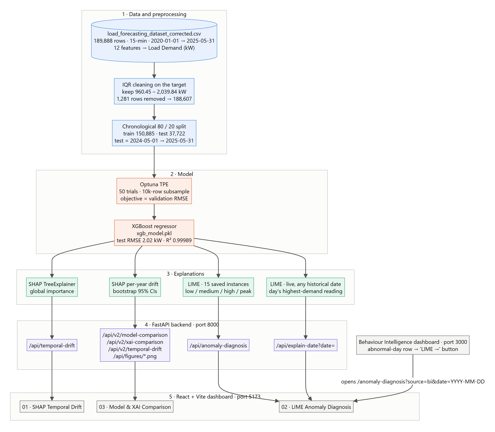
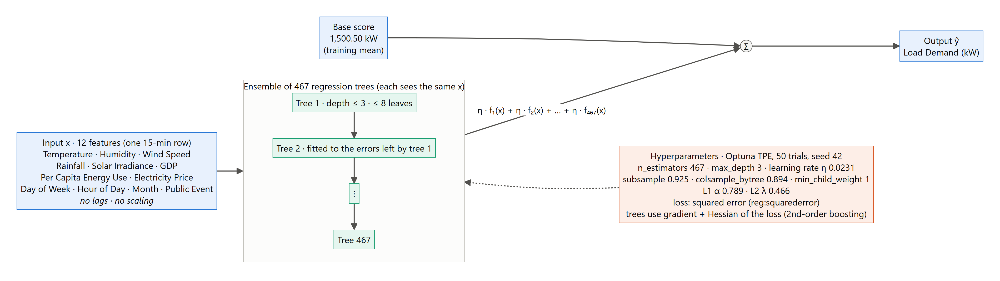

# Handover: your XAI component, ready for the final viva

**For:** Madushani R.P. (IT22273062) · **Final viva:** 20 October 2026 (10 min presentation · 10 min demo · 35 min viva)

**Prepared:** 18 October 2026 · **Code version:** git tag `viva-final-candidate` in `madushani_xai`

This document explains your component, what was wrong at PP2, what was changed, the numbers to remember, and how to run the demo. Read it once fully, then use sections 6, 7 and 11 to practise.

---

## 1. Your component on one page

**The problem.** A machine-learning model can predict electricity demand accurately but cannot say *why*. Energy planners need reasons before they trust a prediction. Your component **explains** a demand-prediction model, both overall and for single moments in time.

**The dataset.** `load_forecasting_dataset_corrected.csv` (stored in `behaviour-intelligence/data/raw/`):
- 189,888 rows, one every 15 minutes, from 2020-01-01 to 2025-05-31.
- 12 input features: Temperature, Humidity, Wind Speed, Rainfall, Solar Irradiance, GDP, Per Capita Energy Use, Electricity Price, Day of Week, Hour of Day, Month, Public Event.
- Target: **Load Demand (kW)**.

**The model.** An **XGBoost** regressor:
- 467 small decision trees, each at most 3 levels deep.
- Tuned with **Optuna**.
- Test error: **2.02 kW RMSE**, which is 0.07% of average demand.

**The two explanation (XAI) methods:**
- **SHAP** gives *global* importance (which features matter most overall) and *temporal* importance (does this change year by year?).
- **LIME** gives a *local* explanation: why one specific 15-minute reading got its prediction, written as simple rules like "Temperature > 29.29 → +359 kW".

**The dashboard** (React, `http://localhost:5173`) has 3 pages:

| Page | What it shows |
|---|---|
| **01 · SHAP Temporal Drift** | SHAP importance per year, rankings, drift chart, model comparison table |
| **02 · LIME Anomaly Diagnosis** | 15 example explanations (low / medium / high / peak demand), plus live explanations for dates sent from BI |
| **03 · Model & XAI Comparison** | All comparison results: models, SHAP vs LIME, drift with confidence intervals |

**Connection to Behaviour Intelligence (BI).** Thanujan's BI dashboard (`http://localhost:3000`) finds abnormal days. Each abnormal day has a **"LIME →"** button. It opens your page with that date (`/anomaly-diagnosis?source=bi&date=2025-01-25`), and your backend calculates a fresh LIME explanation for that day.



---

## 2. PP2 panel feedback: what they asked for

| # | Panel comment | What it meant |
|---|---|---|
| 1 | "Lacks idea on the models used" | You must clearly name every model and method, say what each one does, why you chose it, and its settings. |
| 2 | "Need to have a clear idea on the model architecture" | You must explain *how* XGBoost works inside (trees, boosting, loss, hyperparameters) and how the whole system fits together, ideally with diagrams. |
| 3 | "A model comparison needs to be done" | You must compare your model with other models using proper metrics, and compare the explanation methods too. |

---

## 3. What was wrong (found in the audit on 18 Oct)

1. **LIME showed the opposite sign.** The code read the wrong part of LIME's result (`local_exp[0]`, which LIME fills with *negated* weights in regression mode). So on a hot peak day, the screen said high temperature *reduced* demand by about 353 kW. In reality it *increases* demand.
2. **The BI button showed the wrong day.** Your page only searched the 15 saved examples. None of BI's 60 abnormal days matched them, so every click showed example #01 (a *low*-demand reading from 2022-11-04) under a banner claiming it explained the clicked date.
3. **LIME gave different answers each time.** The live explanation used a random generator that kept moving. The same date gave, for example, +352 kW and then +335 kW.
4. **The "drift" was noise.** The old drift analysis trained a new model for every year on only 2,000 rows, with no uncertainty estimate. "Rainfall is the biggest gainer" was random variation, not a real change.
5. **The model comparison was hidden.** It existed in the notebook and the JSON file, but the dashboard never showed it.
6. **The dataset is exactly linear.** `Load = 100 × Temperature − 1300`, with a maximum error of 0.0000005 kW. The other 11 features have **zero** effect. This is why Linear Regression scores a perfect R² = 1.0, and why Temperature dominates every SHAP result. The data is synthetic.

---

## 4. What was done for the final

Each item reads: **before → after → why**, then the files involved.

**1. LIME sign fix.** Before: hot days showed Temperature ≈ −353 kW. After: they show +346 to +363 kW, and intercept + contributions = LIME's local prediction (checked on all 15 examples). Why: the explanation must point the right way. Files: `backend/app.py`, `generate_anomaly_diagnosis.py`, notebook 2 cell 5; `backend/outputs/anomaly_diagnosis.json` regenerated.

**2. BI deep link with live explanation.** Before: every BI click showed example #01. After: the page calls `/api/explain-date` for the clicked date and shows a live LIME explanation of that day's highest-demand reading, with an accurate banner. Dates with no data show "No historical data for this date". Why: the integration must explain the day the user clicked. File: `frontend/src/pages/LimeAnomalyDiagnosis.jsx`.

**3. Fixed random seed.** Before: the same date gave different weights. After: LIME's random generator is reset to 42 before every explanation, and 3 calls for the same date give identical results. Why: a demo must be repeatable. File: `backend/app.py` (`explain_date`).

**4. Drift chart toggle.** Before: Temperature (~157 kW) made the other 11 lines flat at zero. After: Temperature is hidden by default, with a note explaining why, and the drift bar chart has an "Exclude Temperature" button. File: `frontend/src/pages/TemporalDrift.jsx`.

**5. Model comparison on the dashboard.** Before: only in the notebook. After: page 01 shows the comparison and the XGBoost train/test table. File: `TemporalDrift.jsx`.

**6. New experiments script.** Before: one comparison with an untuned Random Forest, one split, no XAI comparison. After: `experiments/model_and_xai_comparison.py` runs with fixed seeds in about 3 minutes and produces 4 JSON files in `backend/outputs/v2/` and 9 figures in `backend/outputs/figures/`. It covers:
- a seasonal-naive baseline, Linear Regression, a Random Forest tuned with the same Optuna budget, and your saved XGBoost;
- 5-fold rolling-origin cross-validation;
- SHAP vs LIME against the ground truth;
- drift with confidence intervals.

It **only reads** your model; it never retrains or overwrites it.

**7. Model & XAI Comparison page.** A new page 03 shows all of the above, with plain-English notes. Files: `frontend/src/pages/ModelXaiComparison.jsx`, `frontend/src/App.jsx`, and new endpoints in `backend/app.py` (`/api/v2/model-comparison`, `/api/v2/xai-comparison`, `/api/v2/temporal-drift`, `/api/figures/…`).

**8. Drift with confidence intervals.** Before: a separate model per year, no uncertainty. After:
- one fixed model, SHAP on every row of each year;
- 20 bootstrap resamples give a 95% confidence interval;
- drift is flagged only when the intervals of two years don't overlap.

Result: no meaningful drift. File: part C of the experiments script.

**9. Dataset check.** We compared your dataset with BI's dataset and the neural team's dataset (section 6). This shows *why* your accuracy is perfect, and that BI's dataset would give more meaningful explanations. Files: `experiments/dataset_check.py`, `DATASET_CHECK.md` (workspace root).

**10. start-all fix.** Before: the BI backend failed to start ("No module named uvicorn"), because Python 3.14 became the default `python`. After: `start-all.py` runs BI with its own environment, `behaviour-intelligence/.venv`, and all 4 components start. File: `start-all.py` (workspace root, not inside your repo).

**11. README, requirements and .gitignore.** Wrong paths and routes in the README were corrected, package versions in `backend/requirements.txt` were pinned, and a broken `.gitignore` was fixed.

**12. Viva pack.** Everything in `madushani_xai/viva/`: diagrams, slide content, demo script, viva notes with 30 questions, screenshots, and `preflight.ps1`.

**Safety.** The original outputs are backed up in `backend/outputs_backup_pp2/` and `D:\Y4S1\Research\xai_model_backup\`. Every change is in git, in `madushani_xai`, tag `viva-final-candidate`.

---

## 5. How each panel comment is now answered

| Comment | Evidence | What to show |
|---|---|---|
| **1. Models used** | Full table of every model and method with role, reason and settings (XGBoost, Optuna, LR, RF, seasonal naive, SHAP, LIME, IQR, demand levels, CV) | Slide 5 · `viva/VIVA_NOTES.md` §2 · dashboard page 03 |
| **2. Architecture** | Five diagrams: system, XGBoost (real hyperparameters read from the saved model), SHAP steps, LIME steps, evaluation design | Slides 4 and 6 · `viva/diagrams/*.png` |
| **3. Model comparison** | 4 models × 6 metrics + 5-fold CV; SHAP vs LIME on 6 criteria against the ground truth; drift with confidence intervals; cross-dataset check | Slides 7–10 · page 03 · `backend/outputs/v2/*.json` · `DATASET_CHECK.md` |

---

## 6. Key results to remember

| Number | What it means |
|---|---|
| **Load = 100 × T − 1300** | The dataset is exactly linear in temperature; the other 11 features do nothing |
| **2.02 kW RMSE · 0.073% MAPE · R² 0.99989** | XGBoost test error on 37,722 rows: tiny |
| **2.10 ± 0.07 kW** | XGBoost RMSE across 5 rolling time folds: stable over time |
| **LR 1.4 × 10⁻⁸ kW · RF 0.011 kW · naive 277.6 kW** | LR is exact (the data is linear); the "no model" baseline is far worse |
| **0.58 ms vs 11.6 ms** | Prediction time per 1,000 rows: XGBoost vs Random Forest (XGBoost is 20× faster) |
| **467 trees · depth 3 · lr 0.0231** | XGBoost's main settings, chosen by Optuna in 50 trials |
| **r = 0.99994, slope 0.999** | SHAP's Temperature values match the true effect almost perfectly |
| **99.90% vs 69.9%** | Share of importance on Temperature: SHAP vs LIME (truth = 100%) |
| **100%** | Both methods rank Temperature #1 with the correct sign on all 200 test rows |
| **0.007 kW** | SHAP's largest additivity error (base value + contributions vs prediction) |
| **LIME R² 0.46 mean · 0.06 for medium** | LIME's local fit is moderate overall and weak for medium demand |
| **±5.7 kW · Jaccard 0.32** | LIME changes a little between random seeds; its 2nd and 3rd features change a lot |
| **2.3 ms vs 15 ms** | Time per explanation: SHAP vs LIME |
| **Temperature 155.7–156.8 kW every year** | No real temporal drift; only Month is flagged (by 0.0017 kW, because 2025 is January–May) |
| **+359.20 kW, R² 0.589** | The live explanation for 2025-01-25 (Temperature > 29.29) |
| **1,894.85 vs 2,766 kW** | 2025-01-25 peak in your dataset vs on the BI dashboard: the two use different files |
| **BI dataset: XGBoost R² 0.78 vs LR 0.30** | On BI's realistic data the comparison is meaningful and 4 features matter: future work |

---

## 7. The main story for the viva

Learn this almost by heart:

> "While checking my results I found that the dataset is exactly linear: demand equals 100 times temperature minus 1300, so the other 11 features have no effect, and that is why Linear Regression scores a perfect R². Instead of hiding this, I used it as a **ground truth**, because now I know the correct explanation. Against it, **SHAP is proven correct**: its temperature values match the true effect with r = 0.99994, and it gives 99.9% of importance to temperature. **LIME finds the right top feature every time**, but it is less faithful (it spreads about 30% of its weight over irrelevant features) and less stable across random seeds. After adding confidence intervals, **there is no real temporal drift**, which is correct for this data. The next step is to retrain on BI's realistic dataset, where several features really matter and the dates match the BI dashboard."

---

## 8. Concepts you must understand

- **XGBoost.** Builds many small decision trees *one after another*. Each new tree fixes the errors left by the trees before it. The final prediction = a starting value (1,500.50 kW, the average demand) + a small step (0.0231) × the sum of all 467 tree outputs. Penalties (L1 0.789, L2 0.466) and random sampling of rows (92.5%) and columns (89.4%) stop it from memorising the data.



- **Optuna.** A tool that tries different hyperparameter combinations and learns which areas look promising (the TPE method). We ran 50 trials and kept the setting with the lowest validation error (2.31 kW).
- **Chronological split.** Train on the past, test on the future: the first 80% of time trains, the last 20% (May 2024 → May 2025) tests. A random split would let the model "see the future", which is cheating.
- **Rolling-origin cross-validation.** Repeat the train-past / test-future idea 5 times, each time moving the cut-off later. This shows whether the result holds in different periods.
- **RMSE / MAE / MAPE / R².**
  - RMSE: average error in kW, with big errors counted more.
  - MAE: plain average error in kW.
  - MAPE: average error as a percentage of actual demand.
  - R²: how much of the variation the model explains (1 = perfect).
- **SHAP.** Gives each feature a fair share of the prediction, based on Shapley values from game theory: each feature's average contribution over every order in which features could be added. The shares always add up: starting value + all shares = prediction. For tree models it is exact.
- **LIME.** Explains one prediction:
  1. it makes 1,000 slightly changed copies of the row,
  2. it asks the model to predict each copy,
  3. it gives more weight to copies close to the original,
  4. it fits a simple weighted linear model.

  Its coefficients are the explanation. Features are split into quartile ranges, so results read like "Temperature > 29.29".
- **LIME R².** How well LIME's simple model copies the real model near that row (1 = perfect copy). It is about 0.6 for low, high and peak demand, but only 0.06 for medium demand, where Temperature falls in the two middle ranges.
- **Temporal drift.** A change over time in how important a feature is. We measured SHAP importance per year.
- **Confidence interval (95%).** A range that very likely contains the true value. We built it by resampling the rows 20 times (bootstrap). If two years' ranges overlap, the difference could be chance, so we don't call it drift.
- **IQR outlier removal.** IQR = the middle 50% range of demand (1,365 to 1,635 kW). Values more than 1.5 × IQR outside it (below 960.45 or above 2,039.84 kW) were removed: 1,281 rows, or 0.67%.

---

## 9. How to run everything

All commands run from the workspace root, `D:\Y4S1\Research\Component1-Behaviour-Intelligence`.

**Viva morning: one command to start and check everything:**
```
powershell -ExecutionPolicy Bypass -File madushani_xai\viva\preflight.ps1
```
It starts all 4 components in a new window (if they are not already running) and runs 29 checks. You want to see **`ALL 29 CHECKS PASSED`**. Keep the new window open; press **Ctrl+C** in it to stop everything at the end.

To start without checks: `python start-all.py`.

**URLs:**

| What | URL |
|---|---|
| Your dashboard | `http://localhost:5173` (pages `/temporal-drift`, `/anomaly-diagnosis`, `/model-xai-comparison`) |
| Your API docs (Swagger) | `http://127.0.0.1:8000/docs` |
| BI dashboard | `http://localhost:3000` |
| Deep link (direct) | `http://localhost:5173/anomaly-diagnosis?source=bi&date=2025-01-25` |

**Demo order** (full script with words to say: `viva/DEMO_SCRIPT.md`):
1. Show the terminal and the preflight result.
2. BI dashboard → the 2025-01-25 row → **LIME →**.
3. Live explanation.
4. Page 01.
5. Page 02 (Peak #15, Medium #04).
6. Page 03 (comparison tables, SHAP proof plot, LIME stability, drift).
7. Swagger: `explain-date` for 2025-01-25 (200) and 2026-10-20 (404).

**If something fails:**
- "Port in use": another copy is already running. Use it, or close it.
- A page says "Could not load data": the backend on 8000 is down. Start it in `madushani_xai\backend` with `..\venv\Scripts\python.exe -m uvicorn app:app --port 8000`.
- BI is down: open the deep link URL directly.
- Nothing works: show the screenshots in `madushani_xai\viva\screenshots\` in demo order (06, 07, 03, 01, 02, 04, 05).

A warning about an "older version of XGBoost" in the backend window is harmless.

---

## 10. Do NOT do before the viva

- **Do not re-run notebook 1.** It retrains the model and overwrites `xgb_model.pkl` and `temporal_drift.json`, so all your numbers would change.
- **Do not change the dataset** or its path, and do not switch to BI's dataset yet (that is future work, about 5–8 hours).
- **Do not edit files in `backend/outputs/`** (including `v2/` and `figures/`) by hand.
- **Do not update packages** (`pip install -U`, `npm update`) or reinstall the Python environments.
- **Do not pull or copy in untested changes** from anyone. If you must change something, run `preflight.ps1` again afterwards.
- Do not delete the backups (`backend/outputs_backup_pp2/`, `D:\Y4S1\Research\xai_model_backup\`).

---

## 11. Top 15 questions to practise

1. **Why XGBoost if Linear Regression is perfect?** LR is perfect only because this dataset is exactly linear, so accuracy can't separate models. XGBoost allows exact, fast SHAP explanations and handles non-linear real data; its error is only 0.07%.
2. **Explain XGBoost's architecture.** 467 shallow trees built one after another; each fixes the previous errors using the gradient of the squared-error loss. Prediction = 1,500.50 kW + 0.0231 × the sum of tree outputs, regularised by L1/L2 and subsampling.
3. **How were the hyperparameters tuned?** Optuna (TPE), 50 trials over 8 parameters, minimising RMSE on the last 20% of the training period. Each trial used a 10,000-row sample; the final model used all 150,885 training rows.
4. **Why a chronological split?** It's time-series data; a random split leaks future information into training and makes results look better than they are.
5. **What is rolling-origin CV and what did it show?** Five train-on-past / test-on-next-period folds. XGBoost's RMSE was 2.10 ± 0.07 kW, so it is stable over time.
6. **Was the comparison fair?** Yes: the same data, split and metrics for all models, and Random Forest got exactly the same Optuna budget as XGBoost.
7. **Difference between SHAP and LIME?** SHAP is based on Shapley values, adds up exactly, and is exact and deterministic for trees. LIME fits a small local model on random samples; it's readable but approximate and can vary.
8. **How do you know SHAP is correct?** The true effect is known (100 × (T − mean T)). SHAP matches it with r = 0.99994 and slope 0.999, and gives 99.9% of importance to Temperature.
9. **Why is LIME's R² low for medium demand?** LIME uses quartile ranges. Medium readings fall in the two middle Temperature ranges, which a simple "in this range or not" model cannot follow, so R² is only 0.06.
10. **Is your dataset real?** No. It is synthetic: the target is exactly 100·T − 1300. I say so openly, and I used it as a ground truth to validate the explanation methods.
11. **Where is the anomaly detection?** In Behaviour Intelligence (Isolation Forest). My component *explains* the days BI flags, through the LIME button.
12. **How does it integrate with other components?** BI's "LIME →" button opens my page with the date, and my backend calculates a live LIME explanation. All 4 components start with `start-all.py`.
13. **What is temporal drift, and did you find any?** A change in feature importance over time. With one fixed model and 95% confidence intervals, there was no meaningful drift; only Month was flagged, by 0.0017 kW, because 2025 has only 5 months.
14. **Why are your kW values different from BI's for the same date?** The two components use different dataset files (2025-01-25: 1,894.85 vs 2,766 kW). The page says so; retraining on BI's dataset is my next step.
15. **What would you do with more time?** Retrain and explain on BI's realistic dataset (there XGBoost R² is 0.78 vs LR 0.30, and 4 features matter), add time-lag features, stabilise LIME, and test the explanations with real users.

All 30 questions with longer answers are in `viva/VIVA_NOTES.md` §7.

---

## 12. File map

**In `madushani_xai/`:**

| Path | What it is for |
|---|---|
| `backend/app.py` | FastAPI backend (port 8000): all endpoints, including live LIME |
| `backend/outputs/xgb_model.pkl` | The trained XGBoost model. **Do not overwrite** |
| `backend/outputs/temporal_drift.json` | SHAP per year + original comparison (from notebook 1) |
| `backend/outputs/anomaly_diagnosis.json` | The 15 saved LIME explanations |
| `backend/outputs/v2/` | New results: `model_comparison_v2.json`, `xai_comparison.json`, `temporal_drift_v2.json`, `dataset_check.json` |
| `backend/outputs/figures/` | 9 figures used on page 03 and in the slides |
| `backend/outputs_backup_pp2/` | Backup of the original outputs and model |
| `backend/requirements.txt` | Pinned Python packages |
| `frontend/src/pages/TemporalDrift.jsx` | Page 01 |
| `frontend/src/pages/LimeAnomalyDiagnosis.jsx` | Page 02, including BI deep-link handling |
| `frontend/src/pages/ModelXaiComparison.jsx` | Page 03 |
| `notebooks/1_shap_temporal_drift.ipynb` | Training, tuning, comparison, yearly SHAP. **Do not re-run** |
| `notebooks/2_lime_anomaly_diagnosis.ipynb` | The 15 LIME explanations |
| `generate_anomaly_diagnosis.py` | Script version of notebook 2 (safe, gives the same result) |
| `experiments/model_and_xai_comparison.py` | Creates everything in `v2/` and `figures/` (reads only) |
| `experiments/dataset_check.py` | Cross-dataset check behind `DATASET_CHECK.md` |
| `README.md` | Component documentation |
| `viva/HANDOVER_FOR_MADUSHANI.md` / `.pdf` | This document |
| `viva/VIVA_NOTES.md` | Detailed notes and 30 questions |
| `viva/SLIDES_CONTENT.md` | Content and speaker notes for 12 slides |
| `viva/DEMO_SCRIPT.md` | Minute-by-minute demo with a backup plan |
| `viva/preflight.ps1` | Start + 29 health checks |
| `viva/diagrams/` | 5 diagrams (PNG for slides, `.mmd` source) |
| `viva/screenshots/` | 9 backup screenshots of every page |
| `viva/tools/` | Scripts that re-create the diagrams, screenshots and this PDF |

**In the workspace root (`D:\Y4S1\Research\Component1-Behaviour-Intelligence\`):**

| Path | What it is for |
|---|---|
| `start-all.py` | Starts all 4 components |
| `MADUSHANI_AUDIT.md` | The full audit of your component (18 Oct) |
| `DATASET_CHECK.md` | Comparison of the three datasets + plan to switch to BI's |
| `behaviour-intelligence/data/raw/load_forecasting_dataset_corrected.csv` | Your dataset (read by your backend). **Do not change** |

Good luck on the 20th. You have strong, honest evidence for all three panel comments.
