# My Simple Presentation Guide

**For:** Madushani (IT22273062)

**Final viva:** 20 October 2026

**Plan:** 10 minutes talk · 10 minutes demo · questions after

You know this work. This guide gives you the words. Read it aloud many times. Practise with a timer. You will do well. 💪

**How to read this guide:**

- 👉 **CLICK:** what you click
- 👀 **SHOW:** what you point at on the screen
- 🗣️ **SAY:** the exact words you say
- ⏱️ **TIME:** how long to spend

<div class="pb"></div>

## 1. My component in 5 sentences

1. My component explains an electricity demand prediction model.
2. The model is called XGBoost. It predicts demand every 15 minutes.
3. I use SHAP to show which features are most important overall.
4. I use LIME to explain one single prediction in simple rules.
5. The Behaviour Intelligence dashboard sends abnormal days to my page, and I explain them.

**Easy meanings:**

- **Feature** = one input to the model, like temperature or month.
- **XGBoost** = a model made of many small decision trees working together.
- **SHAP** = a method that shows how much each feature pushed the prediction up or down.
- **LIME** = a method that explains one prediction with simple rules.
- **Behaviour Intelligence (BI)** = my teammate's component. It finds abnormal days.

<div class="pb"></div>

## 2. Before the viva: checklist

Do these on the morning of 20 October.

- [ ] Laptop is fully charged. The charger is in your bag.
- [ ] The logbook is signed by your supervisor.
- [ ] Turn off notifications (Windows: Focus assist ON).
- [ ] Close all other apps (WhatsApp, email, music).
- [ ] Open a terminal in `D:\Y4S1\Research\Component1-Behaviour-Intelligence`.
- [ ] Run this one command:

```
powershell -ExecutionPolicy Bypass -File madushani_xai\viva\preflight.ps1
```

- [ ] Wait. You must see **ALL 29 CHECKS PASSED** in green.
- [ ] Do not close the new black window. It runs the system.
- [ ] Open the browser tabs **in this order:**
  1. `http://localhost:3000` (BI dashboard)
  2. `http://localhost:5173/temporal-drift` (my page 01)
  3. `http://127.0.0.1:8000/docs` (Swagger, my API)
- [ ] Browser zoom: 100% (or 110% on a projector).
- [ ] Open the folder `madushani_xai\viva\screenshots\guide` in File Explorer. It is your backup.
- [ ] Open your slides.
- [ ] Keep this guide and the cheat sheet (last page) next to you.
- [ ] Drink some water. Breathe slowly. You are ready. 🙂

<div class="pb"></div>

## 3. Presentation (10 minutes, 12 slides)

Speak slowly. It is OK to pause. Each slide is about 50 seconds.

### Slide 1: Title

⏱️ **TIME:** 40 seconds

👀 **On the slide:** "Explainable AI for Electricity Demand Intelligence". My name, ID and supervisor.

> 🗣️ **SAY:** "Good morning. My name is Madushani. My component makes the demand prediction model explainable. I will show the models, the architecture and the comparison. Then I will show a live demo."

### Slide 2: Problem

⏱️ **TIME:** 50 seconds

👀 **On the slide:** Models are accurate but not clear. People need reasons.

> 🗣️ **SAY:** "A model can predict electricity demand well. But it does not say why. Energy planners need the reason before they trust it. Also, explanation methods can be wrong. So I check if they are correct."

### Slide 3: Objectives

⏱️ **TIME:** 40 seconds

👀 **On the slide:** Four objectives.

> 🗣️ **SAY:** "I had four goals. First, explain the model overall with SHAP. Second, explain single predictions with LIME. Third, compare models and compare the two methods. Fourth, check if importance changes over the years."

### Slide 4: System architecture

⏱️ **TIME:** 60 seconds

👀 **On the slide:** the diagram `system_architecture.png`.

> 🗣️ **SAY:** "This is my full system. The data has about 190 thousand rows, every 15 minutes, from 2020 to 2025. I clean the data and split it by time. Optuna tunes the XGBoost model. SHAP and LIME explain it. A FastAPI backend sends results to my React dashboard. It has three pages. The BI dashboard links to my page."

Easy meanings:

- **FastAPI** = the program that sends data to the web page.
- **React** = the tool used to build the web pages.

### Slide 5: Models and methods used

⏱️ **TIME:** 60 seconds

👀 **On the slide:** a table of all models and methods.

> 🗣️ **SAY:** "At PP2 the panel asked about my models. Here is the full list. XGBoost is my main model. Linear Regression, Random Forest and a simple baseline are for comparison. SHAP gives the importance of each feature. LIME explains one prediction. All settings are fixed, so the results repeat."

Easy meanings:

- **Baseline** = a very simple method to compare against.
- **Random Forest** = many decision trees that vote together.

### Slide 6: XGBoost architecture

⏱️ **TIME:** 60 seconds

👀 **On the slide:** the diagram `xgboost_architecture.png`.

> 🗣️ **SAY:** "XGBoost starts from the average demand, about 1,500 kilowatts. Then it adds 467 small trees, one by one. Each new tree fixes the mistakes of the trees before it. Each tree is only 3 levels deep. Optuna chose these settings in 50 trials."

Easy meaning:

- **Optuna** = a tool that tries many settings and keeps the best one.

### Slide 7: Model comparison

⏱️ **TIME:** 60 seconds

👀 **On the slide:** the comparison table and bar chart.

> 🗣️ **SAY:** "I compared four models on the same data. My XGBoost error is about 2 kilowatts. That is only 0.07 percent. Linear Regression is perfect here. I found out why: in this data, demand is exactly 100 times temperature minus 1300. So accuracy cannot separate the models."

### Slide 8: SHAP results

⏱️ **TIME:** 60 seconds

👀 **On the slide:** the SHAP line chart (dots on a straight line).

> 🗣️ **SAY:** "Because I know the true formula, I can check SHAP. The dots are SHAP values. The line is the true answer. They match almost perfectly: 0.9999. SHAP gives 99.9 percent of importance to temperature, which is correct."

### Slide 9: LIME results

⏱️ **TIME:** 55 seconds

👀 **On the slide:** the LIME bar charts for a peak day and a low day.

> 🗣️ **SAY:** "LIME gives simple rules. On a hot peak day, temperature above 29 degrees adds about 359 kilowatts. LIME always finds temperature first. But its fit is weak for medium demand. I also fixed a sign bug in LIME."

### Slide 10: SHAP vs LIME

⏱️ **TIME:** 55 seconds

👀 **On the slide:** the SHAP vs LIME table.

> 🗣️ **SAY:** "This table compares the two methods. SHAP is exact, fast and gives the same answer every time. LIME finds the right top feature. But it puts about 30 percent of its weight on features that do nothing. So I use SHAP for importance, and LIME for easy local reasons."

### Slide 11: Integration with Behaviour Intelligence

⏱️ **TIME:** 50 seconds

👀 **On the slide:** two screenshots: the BI row, then my live page.

> 🗣️ **SAY:** "My teammate's dashboard finds abnormal days. Each day has a LIME button. It opens my page for that exact date. My backend explains that day live. All four components start with one command."

### Slide 12: Limitations, future work, conclusion

⏱️ **TIME:** 55 seconds

👀 **On the slide:** limitations, future work, conclusion.

> 🗣️ **SAY:** "My dataset is synthetic and very simple. That is a limitation. But it let me prove SHAP is correct. Next, I want to use the BI dataset, where many features really matter. In summary, I answered all three PP2 comments. Thank you."

<div class="pb"></div>

## 4. Demo (10 minutes)

Go slowly. Point with the mouse. Say what you click before you click.

### Step 1: Start the system

⏱️ **TIME:** 0:00 → 0:40

👉 **CLICK:** the black window called `start-all.py` (it is already running from the morning).

👀 **SHOW:** the four `START` lines and the four web addresses.

> 🗣️ **SAY:** "The whole system starts with one command. There are four components. Mine runs on port 8000 and port 5173."

Easy meaning:

- **Port** = a door number. Each program uses its own door.

### Step 2: Health check

⏱️ **TIME:** 0:40 → 1:20

👉 **CLICK:** the terminal. Type: `powershell -ExecutionPolicy Bypass -File madushani_xai\viva\preflight.ps1 -NoStart`

👀 **SHOW:** the green line **ALL 29 CHECKS PASSED**.

> 🗣️ **SAY:** "This check tests every page and every link. All 29 checks pass."

<div class="pb"></div>

### Step 3: BI dashboard: find 25 January 2025

⏱️ **TIME:** 1:20 → 2:10

👉 **CLICK:** the first browser tab (`localhost:3000`). Scroll down to **Recent abnormal days**.

👀 **SHOW:** the row **2025-01-25**. Then 👉 **CLICK:** the **LIME →** button in that row.

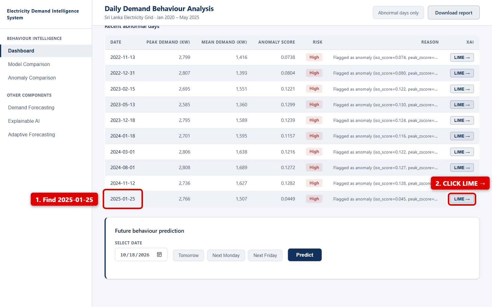

> 🗣️ **SAY:** "This is my teammate's Behaviour Intelligence dashboard. It found 25 January 2025 as an abnormal day. I click the LIME button. It opens my page for this date."

<div class="pb"></div>

### Step 4: The live explanation

⏱️ **TIME:** 2:10 → 3:30

👀 **SHOW:** the new tab. Point to the four boxes at the top. Then point to the first green bar.

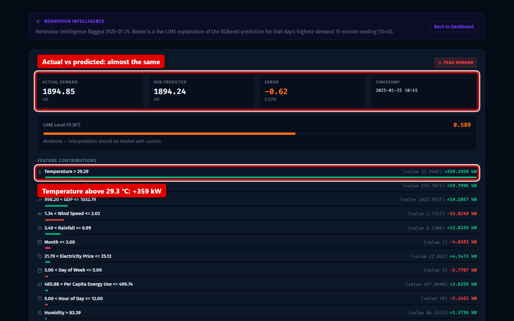

> 🗣️ **SAY:** "My page explains the highest reading of that day, at 10:45. The real demand was about 1,895 kilowatts. My model predicted almost the same. The main reason is temperature above 29 degrees. It adds about 359 kilowatts."

👀 **SHOW:** scroll down a little. Point to the orange bar.

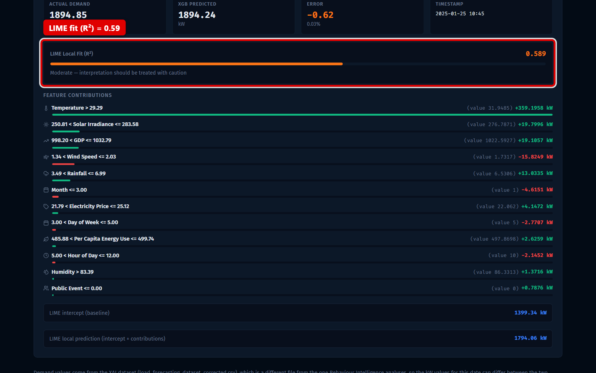

> 🗣️ **SAY:** "This bar shows how well LIME fits here. It is 0.59, so I show it as a warning. If I refresh, I get the same numbers. My values differ from the BI dashboard because we use different data files."

👉 **CLICK:** press **F5** once to refresh. The numbers stay the same.

Easy meanings:

- **R² (R squared)** = a score for fit. 1 is perfect. 0 is no fit.
- **Live** = calculated now, not saved before.

<div class="pb"></div>

### Step 5: Page 01: SHAP Temporal Drift

⏱️ **TIME:** 3:30 → 4:45

👉 **CLICK:** the second browser tab (`localhost:5173/temporal-drift`).

👀 **SHOW:** the summary cards and the red note.

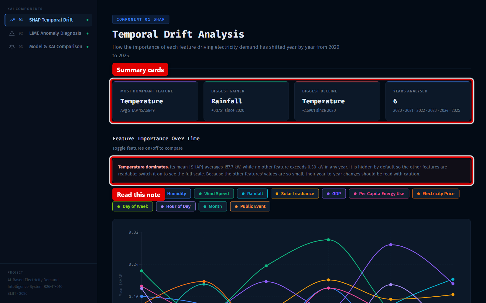

> 🗣️ **SAY:** "This page uses SHAP. Temperature is the strongest feature by far. Its importance is about 157 kilowatts. All other features are below 0.3."

👉 **CLICK:** the **Temperature** button to show it. Then click it again to hide it.

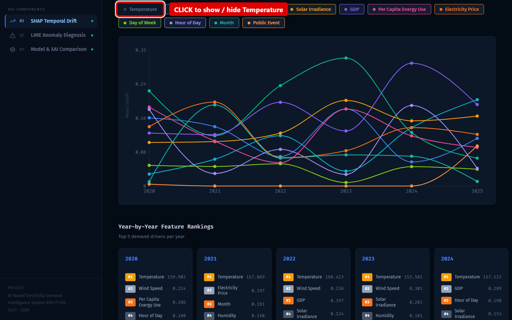

> 🗣️ **SAY:** "When temperature is shown, all other lines become flat. So I hide it by default."

👀 **SHOW:** scroll down to **Forecasting Model Comparison**.

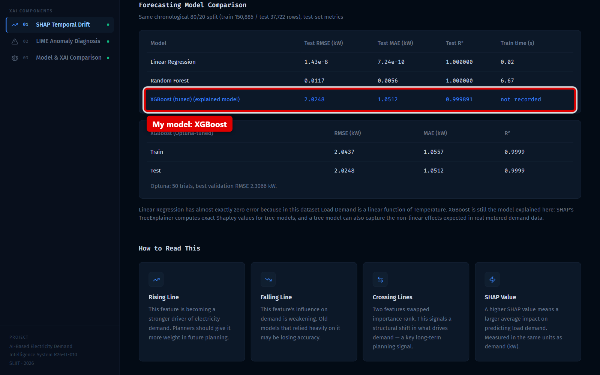

> 🗣️ **SAY:** "This table compares my model with others. My XGBoost error is about 2 kilowatts."

<div class="pb"></div>

### Step 6: Page 02: LIME Anomaly Diagnosis

⏱️ **TIME:** 4:45 → 5:45

👉 **CLICK:** in the left menu, **02 LIME Anomaly Diagnosis**. Then click **Peak**. Then click **#15**.

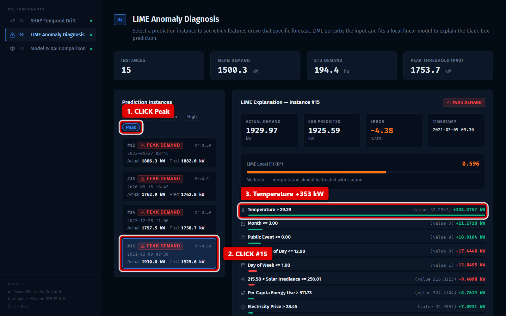

> 🗣️ **SAY:** "These are 15 saved examples. This is a peak day. Temperature in the top range pushes demand up by about 353 kilowatts."

👉 **CLICK:** **Medium**. Then click **#04**.

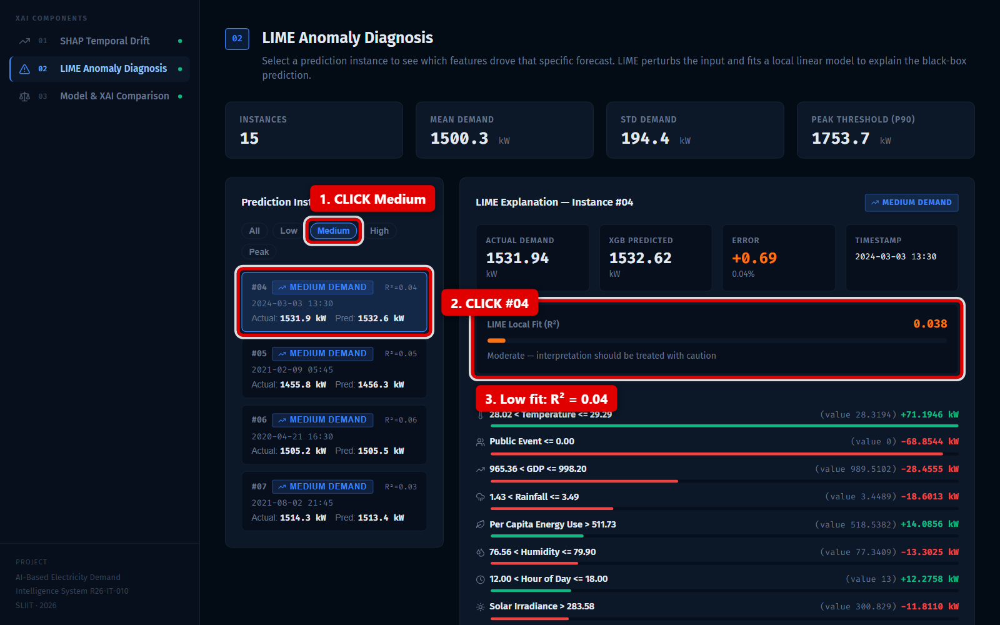

> 🗣️ **SAY:** "This is a medium day. Here the LIME fit is very low, only 0.04. LIME cannot follow the middle temperatures well. The page shows a warning."

<div class="pb"></div>

### Step 7: Page 03: Model & XAI Comparison

⏱️ **TIME:** 5:45 → 8:40 (the most important page)

👉 **CLICK:** in the left menu, **03 Model & XAI Comparison**.

👀 **SHOW:** the red box at the top. Read its first sentence.

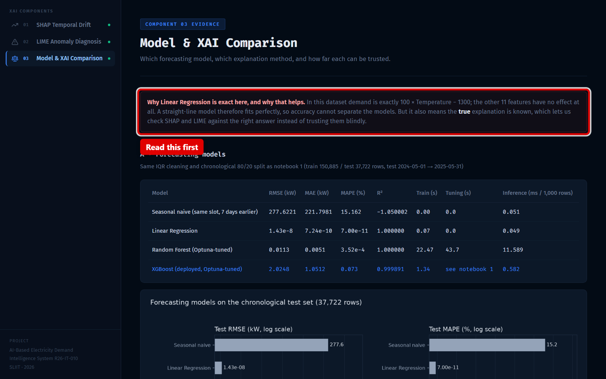

> 🗣️ **SAY:** "In this data, demand is exactly 100 times temperature minus 1300. So I know the true answer. This lets me check if SHAP and LIME are correct."

👀 **SHOW:** scroll to the first table.

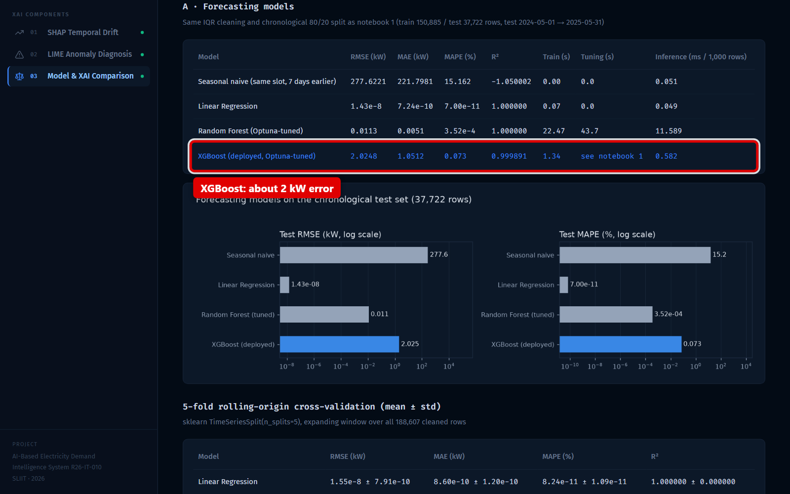

> 🗣️ **SAY:** "All four models use the same data and the same test. Random Forest got the same tuning as XGBoost. XGBoost error is about 2 kilowatts in all five time periods."

<div class="pb"></div>

👀 **SHOW:** scroll to section **B**, the SHAP vs LIME table.

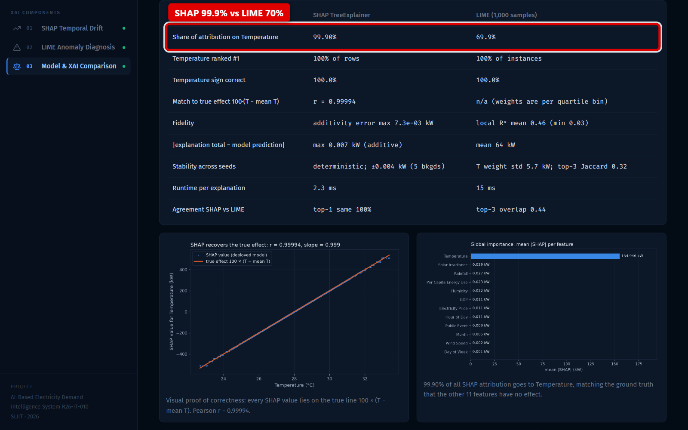

> 🗣️ **SAY:** "Here I compare the two methods. SHAP gives 99.9 percent to temperature. LIME gives about 70 percent. The true answer is 100 percent."

👀 **SHOW:** scroll to the chart with dots on an orange line.

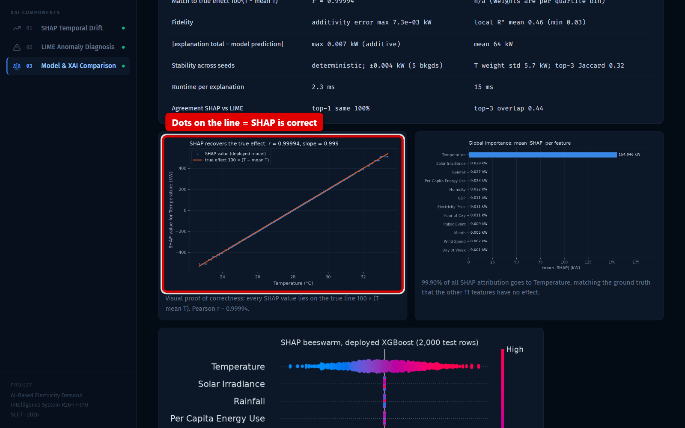

> 🗣️ **SAY:** "This is my key proof. The dots are SHAP. The orange line is the true effect. They are on top of each other. So SHAP is correct."

<div class="pb"></div>

👀 **SHOW:** scroll to the LIME box plot.

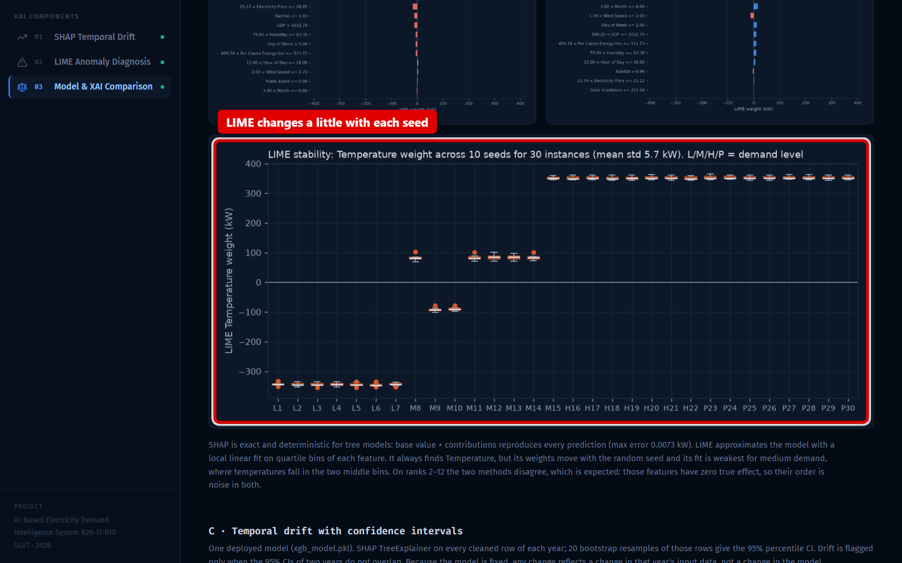

> 🗣️ **SAY:** "I ran LIME ten times with different random seeds. The temperature weight moves by about 6 kilowatts. SHAP gives the same answer every time."

Easy meaning:

- **Random seed** = a starting number for random choices. A different seed gives different random samples.

👀 **SHOW:** scroll to section **C**, the drift chart.

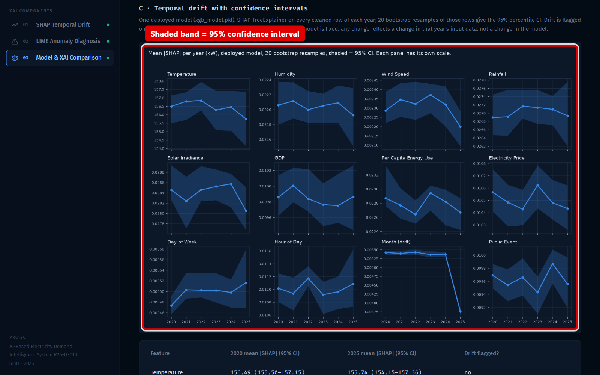

> 🗣️ **SAY:** "This is temporal drift with confidence intervals. The shaded band is the 95 percent range. Temperature stays about the same every year. So there is no real drift."

Easy meanings:

- **Temporal drift** = a change over time in how important a feature is.
- **Confidence interval** = a range where the true value very likely is.

<div class="pb"></div>

### Step 8: Swagger: my API

⏱️ **TIME:** 8:40 → 9:30

👉 **CLICK:** the third browser tab (`127.0.0.1:8000/docs`). Click **GET /api/explain-date**. Click **Try it out**. Type `2025-01-25`. Click **Execute**.

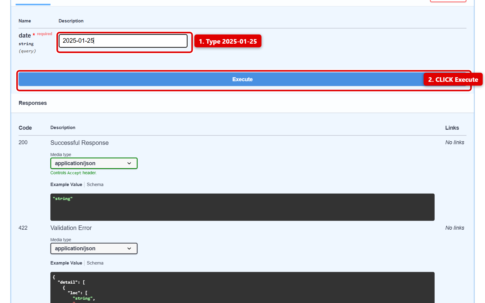

> 🗣️ **SAY:** "All data comes from my API. This is the same live explanation as data."

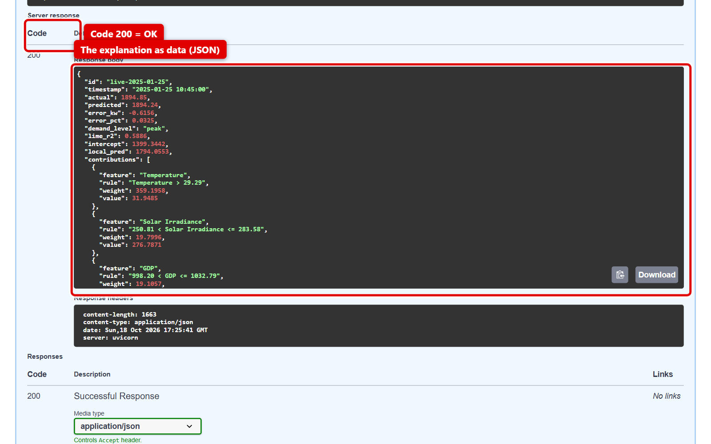

👀 **SHOW:** the code **200** and the data below it.

> 🗣️ **SAY:** "Code 200 means OK. A future date gives code 404, and my page shows a clear message."

Easy meanings:

- **API** = a way for programs to ask for data.
- **Swagger** = a web page that lists and tests the API.

### Step 9: Finish

⏱️ **TIME:** 9:30 → 10:00

👉 **CLICK:** go back to page 03.

> 🗣️ **SAY:** "To finish: I explained the models and the architecture. I compared models and methods with real numbers. And I proved that SHAP is correct. Thank you."

<div class="pb"></div>

## 5. How to explain each chart

When the panel looks at a chart, say these words.

**SHAP bar chart** (one long blue bar)

> 🗣️ "This shows the average importance of each feature. Temperature is about 155 kilowatts. All other features are almost zero. This matches the true formula."

**SHAP line chart** (dots on an orange line)

> 🗣️ "The dots are SHAP values for temperature. The line is the true effect. They match with 0.9999. This proves SHAP is correct."

**SHAP beeswarm** (colourful dots in rows)

> 🗣️ "Each dot is one reading. Red means high temperature. It pushes demand up. Blue means low temperature. It pushes demand down. Other features stay at zero."

**LIME bars** (green and red bars)

> 🗣️ "Green bars push demand up. Red bars push it down. The longest bar is temperature. The other bars are small."

**LIME stability box plot** (orange boxes)

> 🗣️ "Each box is one example, run ten times. The boxes are small, so temperature is stable. But LIME's smaller features change between runs."

**Drift chart** (12 small charts with shaded bands)

> 🗣️ "Each small chart is one feature over the years. The band is the 95 percent range. The bands overlap, so there is no real change."

**Model comparison table**

> 🗣️ "All models use the same data and the same test. XGBoost error is about 2 kilowatts. Linear Regression is perfect because the data is a straight line."

**SHAP vs LIME table**

> 🗣️ "Both methods find temperature first. SHAP is exact, faster and stable. LIME is easier to read but less accurate."

<div class="pb"></div>

## 6. My main story (learn by heart)

1. My dataset is exactly a straight line: demand = 100 × temperature − 1300.
2. So I used it as the true answer to test my methods.
3. SHAP matched the true answer almost perfectly: 0.9999.
4. LIME found the main feature, but it was less stable and less accurate.
5. There was no real drift, and next I want to use the BI dataset.

<div class="pb"></div>

## 7. Viva questions: 20 short answers

**1. What does your component do?**
It explains an electricity demand model. It shows which features matter and why.

**2. Which model do you use?**
XGBoost. It has 467 small trees, each 3 levels deep.

**3. Why XGBoost if Linear Regression is perfect?**
Linear Regression is perfect only because this data is a straight line. XGBoost allows exact SHAP and works on real, curved data.

**4. How does XGBoost work?**
It adds many small trees one by one. Each tree fixes the mistakes of the trees before.

**5. How did you choose the settings?**
I used Optuna. It tried 50 settings and kept the best one.

**6. Why did you split the data by time?**
It is time data. A random split would let the model see the future.

**7. What is rolling-origin cross-validation?**
I trained on the past and tested on the next period, five times. The error stayed about 2 kilowatts.

**8. What is SHAP?**
SHAP shows how much each feature pushed the prediction up or down. The parts always add up to the prediction.

**9. What is LIME?**
LIME changes the input many times and fits a simple model around one prediction. It gives easy rules.

**10. What is the difference between SHAP and LIME?**
SHAP is exact and stable for tree models. LIME is an approximation and can change between runs.

**11. How do you know SHAP is correct?**
I know the true formula. SHAP matches it with 0.9999.

**12. Why is LIME's R² low for medium demand?**
LIME splits temperature into four ranges. Medium values are in the middle ranges, which a simple model cannot follow.

**13. Is your dataset real?**
No, it is synthetic. I say this openly, and I used it to test the methods.

**14. Where is the anomaly detection?**
In the Behaviour Intelligence component. My component explains the days it finds.

**15. How does it connect to the other components?**
The BI dashboard has a LIME button. It opens my page with the date, and I explain it live.

**16. What is temporal drift? Did you find it?**
It is a change in importance over time. After adding confidence intervals, I found no real drift.

**17. What bugs did you fix?**
LIME showed the wrong sign. The BI button showed the wrong day. LIME also changed every time. I fixed all three.

**18. Why are your numbers different from BI's for the same day?**
We use different data files. Using the same file is my next step.

**19. Is your work repeatable?**
Yes. All random seeds are fixed. The script gives the same results every time.

**20. What would you do with more time?**
Use the BI dataset, add past-time features, and explain my teammates' neural models.

<div class="pb"></div>

## 8. If I don't understand the question

It is normal. Use these sentences. Smile. Take your time.

- "Sorry, can you repeat the question, please?"
- "Could you say that a little more slowly, please?"
- "Do you mean …? Let me answer that."
- "That is a good question. Let me think for a moment."
- "Let me show it on the screen. It is easier to explain."
- "Let me show the diagram. It answers this question."
- "I am not fully sure, but I think …"
- "I did not test that part. It is a good idea for future work."
- "Thank you. Can I add one more point?"

**Tip:** If you do not know, say so honestly. Then say what you *do* know. Panels like honest answers.

<div class="pb"></div>

## 9. If something breaks

Stay calm. Say: **"Let me show the screenshot instead."** Then open the screenshot.

| Problem | What to do | Screenshot to open |
|---|---|---|
| A page says "Could not load data" | In the black window, check for errors. Run preflight again. | Use the screenshot for that page |
| BI dashboard does not open | Open this address: `localhost:5173/anomaly-diagnosis?source=bi&date=2025-01-25` | `g01_bi_click_lime.png` |
| Live explanation does not load | Check the date in the address is `2025-01-25` | `g02_live_explanation.png` |
| Page 01 does not load | Refresh with F5 | `g04_page01_top.png` |
| Page 02 does not load | Refresh with F5 | `g07_page02_peak.png` |
| Page 03 images missing | Refresh with F5 | `g11_page03_shap_vs_lime.png`, `g12_page03_shap_proof.png` |
| Swagger does not load | Skip it. Say "The API is the same data." | `g16_swagger_response.png` |
| Nothing works | Close the black window. Run `python start-all.py` again. Wait 20 seconds. | Show all `g01` to `g16` in order |

All screenshots are in `madushani_xai\viva\screenshots\guide\`.

A warning about an "older version of XGBoost" in the black window is harmless. Ignore it.

<div class="pb"></div>

## 10. Hard words list

| Word | Simple meaning | Say it like |
|---|---|---|
| XGBoost | A model made of many small trees | "ex-jee-boost" |
| SHAP | Shows how much each feature pushed the prediction | "shap" (like "map") |
| Shapley value | A fair share of the prediction for each feature | "SHAP-lee" |
| LIME | Explains one prediction with simple rules | "lime" (like the fruit) |
| Optuna | A tool that finds the best settings | "op-TOO-na" |
| Regression | Predicting a number, like kilowatts | "ri-GRESH-un" |
| Chronological | In time order | "kron-uh-LOJ-i-kul" |
| Temporal drift | A change over time | "TEM-pur-ul drift" |
| Confidence interval | A range where the true value likely is | "KON-fi-dens IN-ter-vul" |
| Bootstrap | Taking many random samples of the data | "BOOT-strap" |
| Hyperparameter | A setting chosen before training | "HY-per-pa-RAM-i-ter" |
| Validation | Checking on data not used for training | "val-i-DAY-shun" |
| Quartile | One of four equal parts of the data | "KWOR-tile" |
| Synthetic | Made by a computer, not measured | "sin-THET-ik" |
| Anomaly | Something unusual | "uh-NOM-uh-lee" |
| Deterministic | Same input, same answer every time | "de-ter-mi-NIS-tik" |
| Explainable AI (XAI) | AI that shows its reasons | "ex-PLAY-nuh-bul ay-eye" |
| Kilowatt (kW) | A unit of electric power | "KIL-oh-wot" |
| RMSE | Average error, big errors count more | "R-M-S-E" (say the letters) |
| MAPE | Average error in percent | "mape" (like "tape") |
| R² | Fit score, 1 is perfect | "R squared" |
| API | A way for programs to ask for data | "A-P-I" |
| Swagger | A web page to test the API | "SWAG-er" |

<div class="pb"></div>

<div class="cheat">

## 11. Cheat sheet (keep this beside you)

**10 numbers**

1. Demand = **100 × temperature − 1300**
2. About **190,000 rows**, every **15 minutes**
3. **467 trees**, **3 levels** deep
4. Error about **2 kW** (**0.07 %**)
5. SHAP matches truth: **0.9999**
6. SHAP **99.9 %** vs LIME **70 %** on temperature
7. LIME top feature right: **100 %**
8. LIME fit: about **0.6** for most days (only **0.06** for medium)
9. Live 25 Jan 2025: **+359 kW** from temperature
10. No real drift: temperature about **156 kW** every year

**5 sentences**

1. The data is a straight line, so I know the true answer.
2. SHAP matches the true answer almost perfectly.
3. LIME finds the main feature, but is less stable.
4. There is no real change over the years.
5. Next, I will use the BI dataset.

</div>
